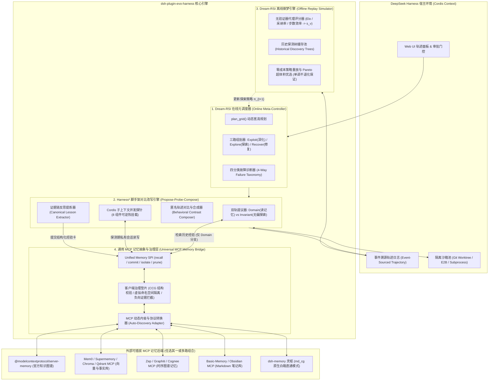

# `dsh-plugin-evo-harness` 架构设计文档 (ARCHITECTURE.md)

> **定位**：基于 `DeepSeek Harness (Cordis)` 构建的测试时自适应自进化智能体插件。  
> **核心融合**：`DeepSeek Harness`（插件化底座） + `Harness²`（8 组件无监督对比改写） + `Dream-RSI`（自适应搜索树与离线重放做梦） + `Universal MCP Memory`（全兼容 MCP 记忆适配与治理层）。

---

## 目录

1. [架构愿景与四方职责边界](#1-架构愿景与四方职责边界)
2. [系统总体架构图](#2-系统总体架构图)
3. [核心模块一：基于 Cordis 的 8 组件可逆热插拔引擎（Harness² 层）](#3-核心模块一基于-cordis-的-8-组件可逆热插拔引擎harness²-层)
4. [核心模块二：通用 MCP 记忆抽象与治理层](#4-核心模块二通用-mcp-记忆抽象与治理层-universal-mcp-memory-bridge)
5. [核心模块三：融合 Dream-RSI 的在线自适应探测与离线做梦引擎](#5-核心模块三融合-dream-rsi-的在线自适应探测与离线做梦引擎)
6. [插件目录结构与核心接口定义](#6-插件目录结构与核心接口定义)
7. [端到端运行时序](#7-端到端运行时序-end-to-end-execution-flow)

---

## 1. 架构愿景与四方职责边界

本插件旨在解决开放世界长程任务中“模型权重冻结下，如何低成本、高安全地实现脚手架（Harness）与探索策略（Policy）双重自进化”的核心问题。四个上游仓库在本架构中的职责划分如下：

| 核心层级 | 源自项目 | 在本插件中的核心职责 |
| :--- | :--- | :--- |
| **宿主运行时底座**<br>(Runtime Substrate) | **`deepseek-harness` (`dsh`)** | 提供 Cordis 上下文树（`ctx`）与可逆副作用（Reversible Effects）、事件溯源轨迹日志（Event-Sourced Trajectory Log）、沙箱隔离（Local/E2B）与权限门控。 |
| **脚手架编辑器**<br>(Object-Level Editor) | **`Harness²`** | 将包裹模型的 **8 大可编辑组件** 抽象为优化表面；在无真值验证器（Verifier-Free）场景下，通过 **Propose–Probe–Compose** 对比执行轨迹的行为差异，动态改写脚手架。 |
| **元搜索与离线进化器**<br>(Meta-Controller & Dreamer) | **`Dream-RSI`** | 在线阶段：用 **动态树搜索（`plan_grid` + 利用/探索/恢复三路组批）** 替代 `Harness²` 死板的 4k 预算；<br>离线阶段：将历史探测树作为 **重放模拟器（Replay Simulator）**，零执行成本进化调度策略。 |
| **可插拔记忆与防火墙层**<br>(Universal Memory Layer) | **全网 MCP 记忆插件**<br>（含 **`dsh-memory` 灵枢**） | 通过标准 MCP 协议接入任意外部记忆服务（Mem0、Zep/Graphiti、Official KG、Basic-Memory、Chroma、灵枢等），由插件内置的**客户端治理垫片**统一补齐写入闸门、会话隔离与负证据防火墙。 |

---

## 2. 系统总体架构图



---

## 3. 核心模块一：基于 Cordis 的 8 组件可逆热插拔引擎（Harness² 层）

Harness² 定义了包裹大模型的 8 个可编辑表面。在 DeepSeek Harness 中，我们摒弃原版频繁拷贝磁盘目录并重启 CLI 的高开销做法，直接将这 8 个组件映射为 Cordis 子上下文（`ctx.fork()`）的可逆插件副作用（Reversible Effects）：

| `Harness²` 8 大组件 | 在 `dsh` Cordis 中的映射接缝 (Capability Seam) | 探测期（Probe）热挂载与回滚机制 |
| :--- | :--- | :--- |
| **1. `system_prompt`** | `ctx.prompt.registerSegment('system', ...)` | 在 forked 子上下文中覆写核心角色指令，探测结束直接 `dispose()`。 |
| **2. `guardrails`** | `ctx.prompt.registerSegment('guardrails', ...)` + `ctx.permissions` | 注入输出格式契约、禁止动作列表及工具前置校验规则。 |
| **3. `memory`** | `ctx.evoMemory.createScopedView(branchId)` | 绑定当前探测分支专属的工作态草稿本与 MCP 记忆隔离视图。 |
| **4. `tool_guidance`** | `ctx.tools.patchDescriptions(...)` | 动态重写工具描述、调用优先级与参数示例（不改动底层工具实现）。 |
| **5. `skills`** | `ctx.skills.mountDynamic(skillMarkdown)` | 内存态挂载临时生成的 `SKILL.md` 领域标准作业程序（SOP）。 |
| **6. `scripts`** | `ctx.sandbox.mountScript(path, code)` | 将生成的 Python/Bash 辅助脚本写入分支独占的沙箱工作区或 Git Worktree。 |
| **7. `subagents`** | `ctx.subagents.register(spec)` | 动态注册专门用于分解当前任务的子智能体配置。 |
| **8. `plugins`** | `ctx.middleware.use(hookFn)` | 在工具调用循环（Tool Loop）前后挂载动态生成的 TS/JS 拦截器中间件。 |

---

## 4. 核心模块二：通用 MCP 记忆抽象与治理层 (Universal MCP Memory Bridge)

设计目标：不绑定任何单一记忆实现，兼容市面上 95% 以上基于 MCP 协议的记忆插件；同时将 `dsh-memory`（灵枢）的白箱安全思想下沉为插件内置的**「客户端治理垫片（Client-Side Governance Polyfill）」**，让普通向量库或图谱 MCP 也能自动获得“防负迁移、防探测污染、结构化校验”的能力。

### 4.1 统一经验载体协议：Canonical Lesson Envelope (CCG 兼容超集)

无论底层接的是 Mem0、官方知识图谱还是灵枢，Harness² 的 Reflector 统一生成如下标准 JSON/Markdown 双模结构（兼容灵枢 CCG 六要素）：

```typescript
export interface CanonicalLesson {
  id: string;
  title: string;                   // 1. 功能名 (Function Name)
  whenToApply: string[];           // 2. 生效条件 (Trigger Cues / Domain Conditions)
  subFunctions: string[];          // 3. 子功能 (Modified Harness Components: e.g., ['guardrails', 'skills'])
  executionPatch: {                // 4. 执行动作 (Concrete Harness Edits / SOP)
    summary: string;
    componentDiffs?: Record<string, string>;
  };
  verificationEvidence: {          // 5. 验证方式 (Behavioral Contrast Evidence from Probe)
    referenceFailure: string;
    candidateSuccess: string;
    metricsDelta: { stepsDiff: number; toolErrorsDiff: number };
  };
  whenNotToApply: string[];        // 6. 不适用条件 / 克制条款 (Restraint Clauses - 防止跨领域负迁移)

  // 元数据治理字段
  polarity: 'positive' | 'negative'; // 正向采纳经验 vs 探测失败反例
  visibility: 'branch_private' | 'session' | 'global';
  sessionId: string;
  branchId?: string;
}
```

### 4.2 MCP 记忆后端自动发现与协议转换矩阵 (Auto-Discovery Adapter)

插件启动时，通过调用 MCP Client 的 `tools/list` 对已挂载的 MCP Server 进行特征指纹嗅探（Fingerprinting），自动匹配内置的 5 类标准驱动适配器（Drivers），也支持用户在配置文件中通过 JSONPath 自定义工具名映射：

| 适配器类型 | 代表性开源 MCP 插件 | 自动识别的工具指纹 (`tools/list`) | `recall()` 映射方式 | `commit()` 映射方式 |
| :--- | :--- | :--- | :--- | :--- |
| **1. Graph-Entity Driver**<br>（实体关系图谱类） | `@modelcontextprotocol/server-memory`<br>`cognee-mcp` | `create_entities`, `create_relations`, `add_observations`, `search_nodes` | 调用 `search_nodes` 检索 `Lesson` 实体及其关联的 `Condition` 节点。 | 将 `CanonicalLesson` 拆分为 `Lesson` 实体 + `APPLIES_WHEN` / `AVOID_WHEN` 关系边写入。 |
| **2. Vector-Fact Driver**<br>（语义向量与事实库类） | `mem0-mcp`, `supermemory-mcp`, `qdrant-mcp`, `chroma-mcp` | `add_memory` / `store_memory` / `qdrant-store`, `search_memory` / `qdrant-find` | 将任务特征拼装为 Query 调用 `search_memory`，携带 metadata 过滤条件。 | 将六要素序列化为结构化 Markdown 存入 text，并将 `whenNotToApply`、`polarity`、`sessionId` 写入 `metadata`。 |
| **3. Temporal-Graph Driver**<br>（时序情节图谱类） | `graphiti-mcp` (Zep), `letta-mcp` | `add_episode` / `add_memory`, `search_facts` / `search_nodes` | 调用 `search_facts` 结合时间窗口拉取近期演进的脚手架经验。 | 将一次 `Propose-Probe-Compose` 对比记录作为完整 `episode` 提交。 |
| **4. Markdown-Note Driver**<br>（文档/笔记库类） | `basic-memory`, `obsidian-mcp`, `filesystem-mcp` | `write_note`, `read_note`, `search_notes`, `build_context` | 调用 `search_notes` 检索带有 `#harness-lesson` 标签的笔记。 | 将 `CanonicalLesson` 渲染为带 YAML Frontmatter 的标准 Markdown 文件写入指定目录。 |
| **5. Native Whitebox Driver**<br>（灵枢原生直通驱动） | **`dsh-memory` (灵枢 `md_cg`)** | `cg`, `stg`, `mdcg_remember`, `mdcg_recall` | 直接调用 `cg(op='route')` 走零 LLM 白箱条件路由与 `stg(op='timeline')`。 | 直接构造 `# 功能名：` 六行要素文本调用 `cg(op='write')`，交由灵枢原生三道闸门裁决。 |

### 4.3 客户端治理垫片 (Client-Side Governance Polyfill)

当用户使用的是第 1~4 类通用 MCP 记忆插件（它们本身没有灵枢的白箱闸门、没有负向防火墙、甚至不支持分支级会话隔离）时，本插件的 `GovernancePolyfillMiddleware` 会自动在客户端介入，提供三项兜底能力：

1. **客户端前置写入闸门（Pre-Write Deterministic Gate）**
   - 在向任何 MCP Server 发送写请求前，垫片层用确定性正则与 AST 检查：
     - 若 `whenToApply`（生效条件）或 `whenNotToApply`（克制条款）为空，或者缺少 `verificationEvidence`（Probe 对比证据），直接在客户端拦截拒绝写入，防止模糊、泛化的毒化经验进入向量库。
     - 若经验中包含自动生成的脚本（`scripts`），先在本地做语法树（AST）解析验证，通过后才允许写入 MCP。
2. **虚拟命名空间隔离垫片（Virtual Namespace Session Isolation）**
   - 在 Harness² 并行运行多个 Probe 分支时，为防止分支 A 的临时记忆污染分支 B：
     - 若底层 MCP 支持 `user_id` / `session_id` / `metadata`（如 Mem0），自动注入 `namespace: "probe_${sessionId}_${branchId}"`。
     - 若底层 MCP 不支持元数据过滤（如基础版 `server-memory` 或 `qdrant-mcp`），垫片层自动在实体名或文本块头部注入隐式前缀标签 `[SCOPE:probe_${branchId}]`，并在读取时按前缀过滤；仅当分支在 Compose 阶段胜出后，才剥离前缀重新写入 `[SCOPE:global]`。
3. **客户端召回后负证据防火墙（Post-Recall Negative Firewall）**
   - 普通向量 MCP Server 经常因为词面相似，把“失败教训（不要怎么做）”当成“推荐做法”召回，或者把 A 领域的重度核查流程错误召回到 B 领域简单任务中。
   - 垫片层在收到 MCP 的 search 结果后，执行两步客户端重排与清洗：
     - **克制条款一票否决**：提取当前任务的上下文标签，若命中记忆条目中的 `whenNotToApply`（不适用条件），直接从召回列表中剔除。
     - **正负向分流注入**：将 `polarity === 'negative'` 的失败探测记录从“推荐经验区”剥离，单独放入 Prompt 的 `<anti_patterns_to_avoid>` 警告槽位中，彻底杜绝语义混淆。

---

## 5. 核心模块三：融合 Dream-RSI 的在线自适应探测与离线做梦引擎

### 5.1 在线阶段：用动态发现树替代 Harness² 固定 4k 预算

原版 Harness² 只能二选一跑纯并行（`--mode parallel`）或纯串行（`--mode sequential`）。本插件将单任务的脚手架调优建模为一棵 Dream-RSI 动态发现树 `T`：

1. **`plan_grid(task, memoryHints)` 动态预算规划**
   - 任务启动前，根据复杂度与 MCP 记忆库中相似任务的命中置信度，动态决定本轮搜索树的最大宽度 `W` 与深度 `D`（简单任务且高置信命中历史经验时退化为 `W=0` 直接零探测执行；完全未知的硬骨头任务自动分配多步树搜索预算）。
2. **三路批次组合（Three-Way Batch Portfolio）**
   - 每轮并发探测批次 `C ⊆ A(T)` 由三种槽位混合组成：
     - **Exploitation（深化槽）**：基于上一轮 Probe 轨迹对比中表现最好的候选脚手架节点，继续叠加修改。
     - **Exploration（探索槽）**：从初始根节点分叉新的修改方向。严格执行**非对称记忆注入（Asymmetric Memory Injection）**：
       - **Domain 分支**：注入从 MCP 记忆插件召回的历史经验；
       - **Invariant 分支**：强制屏蔽外部 MCP 记忆（Guidance-Free），仅基于原始参考轨迹做第一性原理改进，防止历史错误前提污染整棵搜索树。
     - **Recovery（恢复槽，最多占 1 槽位）**：结合 Dream-RSI 的四分类故障诊断法。当某个候选分支因为新写的中间件插件（`plugins`）或脚本（`scripts`）存在语法/接口小 Bug 报错时，将其归类为 **Repairable Implementation Failure（可修复实现故障）**，定向修复代码，而非直接丢弃该分支的设计思路。

### 5.2 离线阶段：无验证器代理评分与“做梦重放”（Dreaming Replay）

为了在没有 Ground-Truth 验证器的开放世界任务上使用 Dream-RSI 的离线重放算法，本插件设计了**代理奖励转换器（Surrogate Score Bridge）**：

1. **事后代理评分（`s_v ∈ [0, 1]`）生成**
   - 在线任务完成后，根据 Harness² 匿名 Composer / Selector 的裁决结果与 dsh 的事件溯源日志，自动为探测树 `T` 上的每个节点 `v` 计算标量得分 `s_v`：
   - `s_v = w_1 · I(v Selected as Final H*) + w_2 · AdoptionRatio(v) + w_3 · StepEfficiency(v) − w_4 · ToolErrorRate(v)`
2. **零成本历史树重放与单调不退化升级**
   - 在系统空闲或达到 N 个任务周期时，唤醒后台 `DreamWorker`：
     - 让策略优化 Agent 生成 `M` 个候选元调度器 `π^0, …, π^{M-1}`（包含不同的早停阈值、宽深比策略与槽位分配比例），其中 `π^0` 为当前正在使用的策略。
     - 将这 `M` 个策略在缓存的历史探测树池 `H_t = {T_1, …, T_t}` 上进行纯内存因果前缀重放（零大模型调用、零沙箱执行开销），计算多预算偏好 `ρ ∈ {0, 0.25, 0.5, 0.75, 1}` 下的质量-成本 Pareto 超体积得分 `V^m`。
     - 若最优候选策略满足 `V^{m*} > V^0`，则热更新在线调度器为 `π^{m*}`；否则保留 `π^0`（严格保证单调不退化）。

---

## 6. 插件目录结构与核心接口定义

### 6.1 推荐工程目录结构

```text
dsh-plugin-evo-harness/
├── package.json
├── tsconfig.json
├── ARCHITECTURE.md
└── src/
    ├── index.ts                        # Cordis 插件主入口 (注册 ctx.evoHarness 与生命周期钩子)
    ├── config.ts                       # Schema 定义与默认配置
    ├── cordis-seams/                   # [DeepSeek Harness 层] 8 组件可逆热插拔封装
    │   ├── context-forker.ts           # 基于 ctx.fork() 的轻量分支隔离器
    │   └── eight-surfaces.ts           # SystemPrompt/Guardrails/Skills/Plugins 等 8 接缝挂载器
    ├── harness2/                       # [Harness² 层] 无监督对比改写核心
    │   ├── proposer.ts                 # 双轨提议器 (Domain 读记忆 vs Invariant 无偏探索)
    │   ├── prober.ts                   # 沙箱并发探针与轨迹采集器
    │   ├── composer.ts                 # 匿名交付物裁决与行为差异合成器
    │   └── reflector.ts                # 证据链提取与 CanonicalLesson 生成器
    ├── dream-rsi/                      # [Dream-RSI 层] 元搜索与离线做梦重放
    │   ├── discovery-tree.ts           # 探测树数据结构与因果前缀视图 (Prefix-only View)
    │   ├── active-policy.ts            # 当前生效的探索策略 π_t (plan_grid & 3-way portfolio)
    │   ├── failure-taxonomy.ts         # 四分类故障诊断器
    │   ├── surrogate-scorer.ts         # 无验证器事后代理评分器 (Elo + 采纳率 + 效率 -> s_v)
    │   └── offline-dreamer.ts          # 历史树重放模拟器与 Pareto 超体积优选器
    └── memory-bridge/                  # [Universal MCP Memory 层] 全兼容记忆桥与治理垫片
        ├── spi.ts                      # IMemoryDriver 统一接口与 CanonicalLesson 定义
        ├── auto-discovery.ts           # MCP tools/list 指纹嗅探与驱动自动绑定器
        ├── governance-polyfill.ts      # 客户端前置写入闸门、虚拟命名空间、负向证据防火墙
        └── drivers/                    # 内置多生态 MCP 适配器
            ├── graph-entity.driver.ts  # 适配 @modelcontextprotocol/server-memory, Cognee
            ├── vector-fact.driver.ts   # 适配 Mem0, Supermemory, Qdrant, Chroma
            ├── temporal.driver.ts      # 适配 Zep / Graphiti, Letta
            ├── markdown-note.driver.ts # 适配 Basic-Memory, Obsidian MCP
            ├── lingshu-mdcg.driver.ts  # 适配 dsh-memory (灵枢原生白箱直通)
            └── custom-mapped.driver.ts # 用户自定义 JSONPath 工具映射驱动
```

### 6.2 核心配置示例 (cordis.yml)

用户可在 DeepSeek Harness 的配置文件中自由切换任意 MCP 记忆插件，无需修改任何业务代码：

```yaml
plugins:
  # 1. 挂载任意标准 MCP 客户端 (可同时挂载多个或任选其一)
  "@deepseek-harness/plugin-mcp":
    servers:
      # 示例 A: 使用 Mem0 MCP Server
      mem0:
        command: "npx"
        args: ["-y", "@mem0/mcp-server"]
        env:
          MEM0_API_KEY: "${MEM0_API_KEY}"

      # 示例 B: 或使用官方 Knowledge Graph Memory Server
      # official_kg:
      #   command: "npx"
      #   args: ["-y", "@modelcontextprotocol/server-memory"]

      # 示例 C: 或使用 dsh-memory (灵枢) 原生白箱服务
      # lingshu:
      #   command: "python3"
      #   args: ["-m", "md_cg.mcp_server"]
      #   env:
      #     MDCG_TOKEN: "${MDCG_DESIGNER_TOKEN}"

  # 2. 挂载本自进化插件
  "dsh-plugin-evo-harness":
    # 触发模式: 'auto_fallback' (常规执行受阻/报错时介入) | 'always' | 'slash_command' (/evo)
    triggerMode: "auto_fallback"

    # 记忆桥配置 (兼容任意 MCP 记忆插件)
    memoryBridge:
      # 'auto' 会自动嗅探已挂载的所有 MCP Server 并绑定对应驱动；也可指定具体 server 名如 'mem0'
      mcpServerTarget: "auto"
      # 强制开启客户端治理垫片 (为普通 MCP 补齐 CCG 六要素校验、探测隔离与负向防火墙)
      enableGovernancePolyfill: true
      # 若使用小众自定义 MCP 记忆插件，可通过 customMapping 手动指定工具名映射
      customMapping:
        enabled: false
        recallToolName: "my_custom_search"
        commitToolName: "my_custom_upsert"

    # Dream-RSI 在线探测与离线做梦配置
    dreamRsi:
      maxOnlineRolloutBudget: 8          # 单任务最大动态探测上限 (由 plan_grid 动态裁剪)
      enableAsymmetricGuidance: true     # 开启非对称记忆注入 (Invariant 分支屏蔽历史记忆防过拟合)
      offlineDreamTriggerEveryNTasks: 10 # 每完成 10 个任务触发一次后台零成本历史树重放进化
      candidatePoliciesCount: 6          # 每次做梦生成的候选调度策略数 M
```

---

## 7. 端到端运行时序 (End-to-End Execution Flow)

1. **任务接入与记忆路由（Route & Plan）**
   - 用户在 dsh 中下达复杂开放任务。
   - MemoryBridge 通过 auto-discovery 识别当前激活的 MCP 记忆插件（如 Mem0 或 Official KG 或灵枢），调用 `recall()` 拉取相关经验，并经由**客户端负向防火墙**过滤掉命中 `whenNotToApply`（不适用条件）的条目。
   - Dream-RSI 在线调度器运行 `plan_grid()`，结合任务复杂度与记忆命中度，动态分配本轮探测树的宽度与深度预算。
2. **非对称双轨提议（Asymmetric Propose）**
   - 若需要探测调优，调度器按 Exploitation / Exploration / Recovery 分配并发槽位：
     - **Domain 探测槽**：结合召回的正向经验与负向反例警告，针对性地修改 8 大组件（如注入领域 `SKILL.md` 和 Guardrails）。
     - **Invariant 探测槽**：不读取任何外部历史记忆，仅根据参考分支（Reference Run）暴露的工具报错或推理卡点，编写通用脚本（`scripts`）或中间件插件（`plugins`）。
3. **Cordis 隔离探测与虚拟命名空间保护（Isolated Probe）**
   - 每个候选分支通过 `ctx.fork()` 创建独立的 Cordis 子上下文和沙箱工作树（Worktree/E2B），热挂载各自的 8 组件修改。
   - 探测执行期间，所有对 MCP 记忆插件的读写均被 GovernancePolyfill 自动打上 `[SCOPE:probe_${branchId}]` 虚拟命名空间标签，确保并发探测分支之间零状态污染。
4. **行为对比合成与代理打分（Compose & Surrogate Scoring）**
   - Harness² 的 Composer 收集参考分支与各探测分支的事件溯源轨迹日志（Event-Sourced Trajectory），在匿名化交付物后通过对比行为差异（Behavioral Contrasts），将有证据支撑的组件修改合并为最终脚手架 `H*` 并输出最终结果。
   - SurrogateScorer 根据各分支被采纳的比例、执行步数与工具错误率，为探测树上的每个节点计算离线代理得分 `s_v`，将完整探测树存入本地 TreePool。
5. **白箱校验沉淀与后台做梦进化（Gated Commit & Offline Dreaming）**
   - Reflector 将本次胜出的修改与失败探测分支分别提炼为正向与负向 `CanonicalLesson`。
   - GovernancePolyfill 执行客户端前置闸门校验（确保六要素完整、包含克制条款与对比证据），通过后调用底层 MCP 插件的写入接口持久化到全局命名空间。
   - 当累计完成 N 个任务后，后台唤醒 OfflineDreamer，在 TreePool 上零成本重放并进化元探索策略 `π_{t+1}`，实现**“脚手架组件库”与“搜索调度算法”的双螺旋自进化**。
