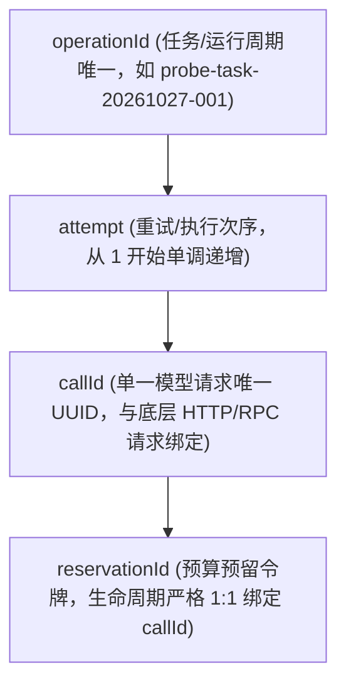
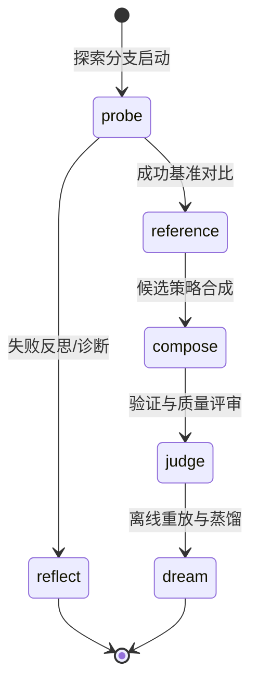
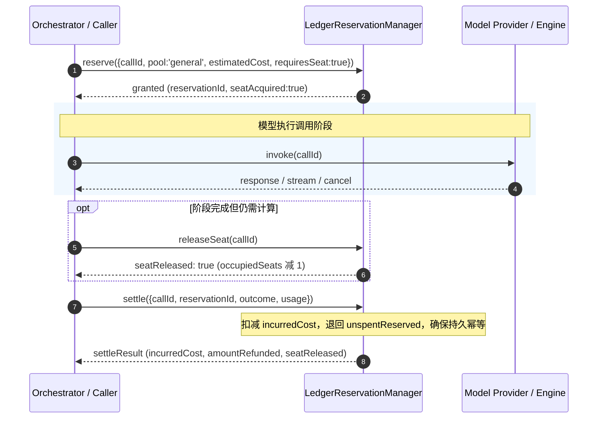
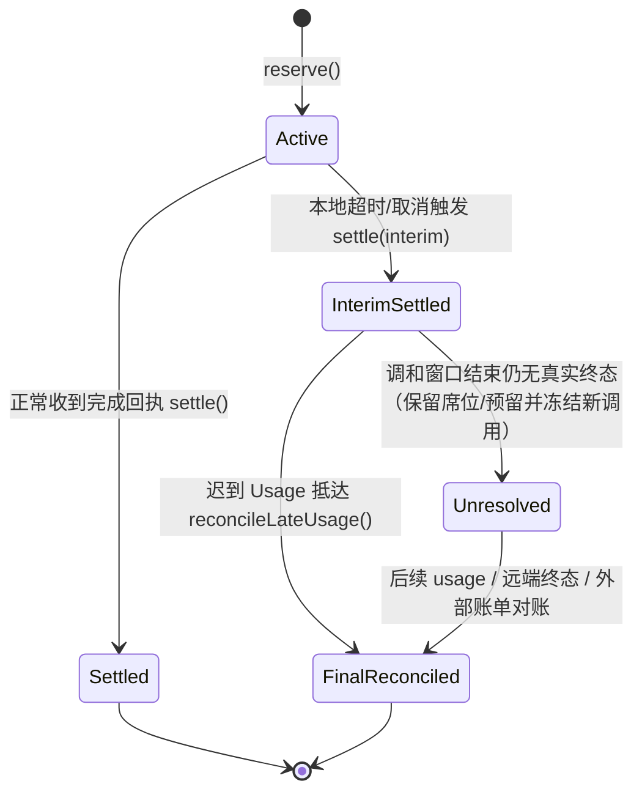
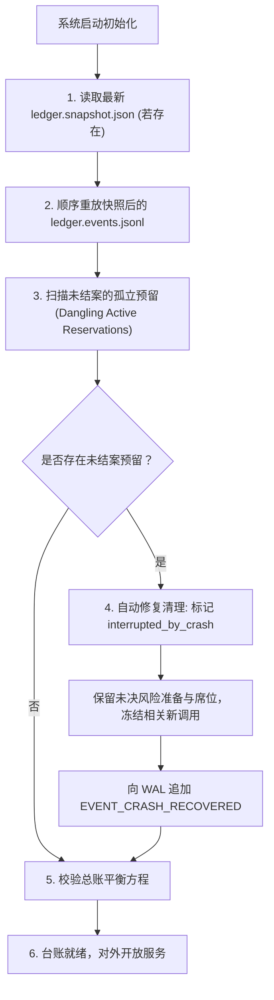
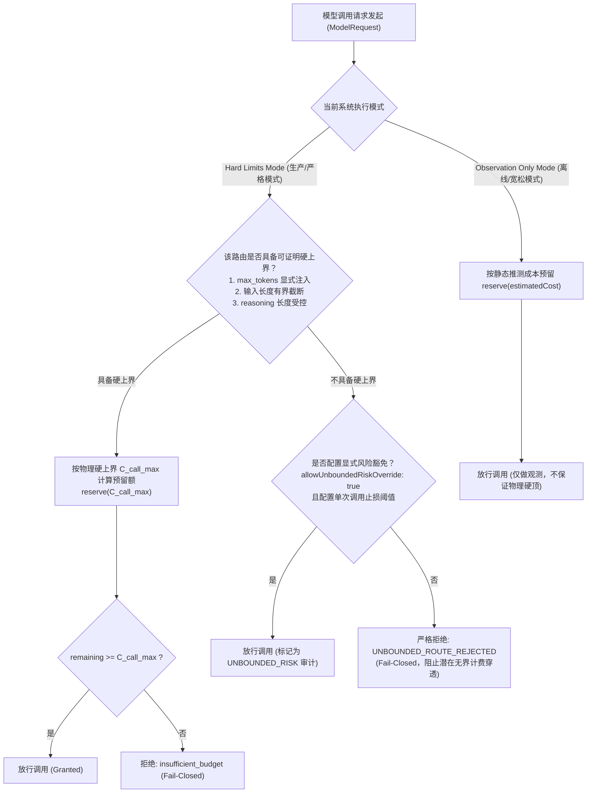
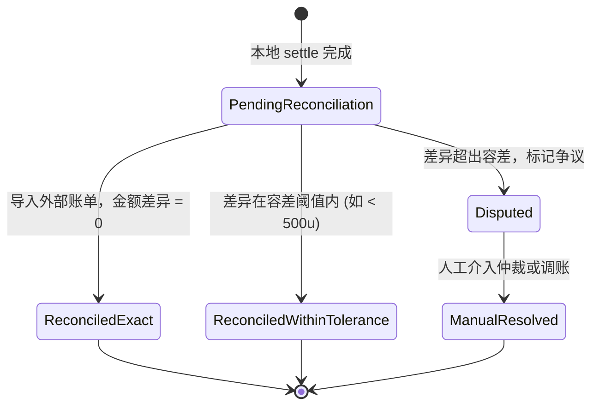

# ADR 0004：C3 真实计量、取消透传、崩溃恢复与有界限额契约（PR-3A + PR-3B 实施设计）

| 项 | 值 |
| --- | --- |
| 状态 | **proposed**（草案，作为 PR-3A 真实计量与恢复、PR-3B 有界限额与对账的实施规范；本轮离线验证，不启用真实付费调用，不发布，不部署） |
| 日期 | 2026-10-27 |
| 代码基线 | HEAD `84a3d828ed2a27eef765c8b9c4950da4a9ee7287`（`feat(p6.2): close C1.1 publish boundary and add C2a trusted local verification`，干净工作树，1 worktree） |
| 决策来源 | ①ADR 0003 §7（C3 准备契约， accepted）；②t1 基线审计报告（`work/t1-baseline-audit.md`）；③Captain 2026-10-27 裁定（ADR 0003 P 表为 `9ea9b7e` 历史台账、正式指纹只认 git blob 原始字节、t6 获 `src/dsh-bridge/model.ts` 最小必要范围修改权限以实现原始 usage 旁路与取消透传、`TokenUsage` 公共形状与 `step-evaluator`/`reward-contract` 保持冻结）；④C3 历史独立复审与综合评审结论（t11、t19、t23、t26） |
| 决策者 | cost-architect（C3 契约架构，起草） & dsh-plugin-evo-rev3 团队（Captain 审核） |
| 影响范围 | `src/dsh-bridge/model.ts`（最小无损旁路与取消透传）、`src/dsh-bridge/agent-loop-executor.ts`（执行循环接线）、`src/ledger/**`（台账核心、事件持久化、崩溃恢复、硬上界限额与对账）、`src/orchestrator.ts`（阶段上下文装配）、`tests/unit/ledger/**`（离线确定性单测与验收夹具） |
| 下游任务 | t6 [pr3a] 真实计量、事件持久化与恢复；t7 [pr3b] 有明确适用边界的预算限额；t13 [preregistration-revision] 五臂正交实验预注册 V2（替代 t8 的错误臂定义，并引用本台账成本口径） |

---

## 1. 背景与现状审计（Why ADR 0004）

在基线 `84a3d82`（继承 ADR 0003 §7）中，C3 已经完成了基础数据契约（`src/ledger/types.ts`、`src/ledger/pricing.ts`、`src/ledger/reservation-manager.ts`、`src/ledger/ledger-event.ts`）以及 11 个离线确定性场景夹具（`scripts/fixtures/ledger/**` 与 `tests/unit/ledger/**`，36 项单元测试全部绿灯通过）。在 t19 与 t23 独立评审中，`actualCostMicros=0` 的 unknown 强制保守非零地板（F-1）与已结算调用重复预留的立即拒绝（F-2）均已彻底关闭。

然而，正如 t1 基线审计所证实的：**当前 C3 仅为离线契约与夹具，在生产链路全仓零接线**（`git grep -n "from './ledger'" -- src` 为空）。若要在后续 PR-3A（t6）与 PR-3B（t7）中安全实施真实成本观测与限额，必须解决以下深层次系统缺陷：

1. **原始 Usage 被强制截断与丢弃**：
   - 宿主原生类型 `DshUsage`（`src/dsh-bridge/model.ts:109-116`）包含完整的 6 个字段：`inputTokens`、`outputTokens`、`totalTokens`、`cacheReadTokens`、`cacheWriteTokens`、`reasoningTokens`；
   - 但转换函数 `usageToTokens`（`:231-247`）只映射了 `inputTokens`、`outputTokens`、`totalTokens`，无情丢弃了 `cacheReadTokens`、`cacheWriteTokens` 和 `reasoningTokens`；
   - `agent-loop-executor.ts:344-357` 的 `addUsage` 同样只累加三字段。这导致在开启 Prompt Caching 或使用长思考链推理模型（如 DeepSeek-R1 / o1）时，真实缓存节省被抹煞，而高昂的 reasoning 费用完全不可见，计价失真可达数十倍。

2. **本地等待终止 vs 远端真实计费的混淆（Promise.race 幻觉）**：
   - 现有取消与超时实现（`agent-loop-executor.ts:571-600`）依赖 `Promise.race` 与本地 `AbortController`；
   - 本地 `Promise.race` 决断仅意味着 Node 运行时放弃了对该 Promise 的 await；如果底层 TCP 连接未硬断开或 Provider 不支持/未收到 abort 信号，**远端模型生成与计费仍在持续进行**；
   - 超时或取消被当成零成本或瞬间释放，导致已发生的真实账单被漏记，探索席位被虚假释放，账本严重失衡。

3. **内存台账无持久化，断电即失忆**：
   - 当前 `LedgerReservationManager` 状态完全保存在进程内存 `Map` 中；
   - 进程异常退出、崩溃或重启后，所有正在执行的活跃预留（active reservations）和历史结算账本荡然无存，既无法进行断点恢复，也无法防范启动后的双重扣减或脏状态。

4. **观测准入与可证明硬上界被严重混淆**：
   - 业界与历史实现中常见三类严重认知误区：
     - *误区 A*：以为设置了 `conservativeFallbackCostMicros`（保守地板）就有了费用保护——地板仅仅是防止未知用量被漏记为 0 的下界兜底，根本无法阻止失控生成导致的向上击穿；
     - *误区 B*：以为 `reserve()` 成功即获得了硬限额——`reserve()` 只是基于静态预估的准入检查，若模型在无界流中持续吐字，实际花费将瞬间击穿预留；
     - *误区 C*：以为 `Promise.race` 设置了 10 秒超时就是成本上限——慢速网络或挂起连接在超时触发前已产生巨额计费。
   - 必须在架构上明确区分**观测准入（Observation Admission）**与**可证明硬上界（Provable Hard Upper Bounds）**。

5. **探索次数与资金额度混为一谈**：
   - 探索席位（Seats / Attempt Counts，无量纲整型）代表系统的物理并发/配额资源；探索资金（Currency Micros，整型微美元）代表法币资产；
   - 释放并发席位不等于退回已产生的法币消耗，探索预算与探索次数严禁在模型中算术相加。

本 ADR 为 PR-3A（t6）和 PR-3B（t7）建立完备、严格、可独立验证的架构契约。

---

## 2. R0：核心原则与绝对边界（Core Principles & Invariants）

本契约确立七项不可动摇的系统级硬不变式：

| 编号 | 核心原则 | 规范定义与约束 | 违反判定 |
| --- | --- | --- | --- |
| **B-1** | **公共契约与奖励标尺绝对冻结** | `src/types/contracts.ts` 中的 `TokenUsage`（三字段）形状保持冻结，绝不修改；`src/jitrl/step-evaluator.ts` 与 `src/jitrl/reward-contract.ts` 中的 `r4/verifier-first-v1` 数值标尺、权重与评估逻辑保持冻结，零修改、零污染。 | 改动 `TokenUsage` 字段或修改 `reward-contract.ts` 权重即判定严重违约。 |
| **B-2** | **最小侵入式无损旁路** | 仅允许在 `src/dsh-bridge/model.ts` 开辟最小必要旁路通道，将完整的 `DshUsage` 与底层取消事件无损引流至 `src/ledger`；上层通用业务代码继续消费标准 `ModelResponse`。 | 在 `dsh-bridge` 之外大规模篡改模型抽象或跨模块引入复杂依赖即判定违约。 |
| **B-3** | **三态精度与显式语义声明** | 每一项 token 指标必须打标为 `measured`（实测）、`estimated`（估算）或 `unknown`（未知）；每一份用量载荷必须显式携带 `CountingSemantics`。严禁隐式猜测 provider 语义。未声明语义一律落入 `unknown` 并施加保守非零地板。 | 出现凭空伪造 `measured` 精度，或未声明语义却逃逸保守地板者判定违约。 |
| **B-4** | **真实取消两阶段原则** | 严禁将本地等待终止（`Promise.race`）等同于远端调用终止。取消分为「本地停止等待」与「远端终止可确认」两阶段；本地停止等待不等于取消成功。取消后已产生的 token 消耗照实结算为 `incurredCostMicros`，且记录强制标记为 `auditOnly: true`, `qualityEvidence: false`。 | 取消或超时后将已产生费用抹零、提前释放仍活跃请求的席位，或将取消记录计为有效质量样本者判定违约。 |
| **B-5** | **席位与金额绝对解耦** | `maxConcurrencySeats`（探索席位，无量纲整型）与 `BudgetPool`（资金池，微美元）属于不同物理量纲。`seatReleased !== amountRefunded`：释放席位仅代表归还并发槽位，不代表资金退款。两者严禁合并或混淆。 | 将席位释放等同于资金返还，或在报表中将次数与金额混加者判定违约。 |
| **B-6** | **准入控制 ≠ 硬上界** | 准入控制（`reserve`）仅代表发起调用的前置许可。唯有具备「强制 `max_tokens` 参数」、「输入长度截断硬顶」且「推理预算封顶」的调用，才具备数学可证明硬上界。无硬上界路由在硬限额模式下必须 `fail-closed` 拒绝，或显式降级为风险豁免模式。 | 声称静态 `reserve` 或本地超时是费用上限者判定违约。 |
| **B-7** | **离线确定性与零真实调用** | 全套实施与验证必须 100% 运行在本地离线环境，使用合成夹具（fake adapter）与离线数据集，不发起任何真实网络请求，不产生任何真实付费 API 账单。 | 实施过程中发起任何真实付费 API 调用即判定违约并立即终止。 |

---

## 3. R1：原始 Usage 无损旁路与分层标识契约（PR-3A）

### 3.1 四级层次化标识体系（Hierarchical Identifiers）

为保证链路追踪、跨模块归账与重试对账的确定性，建立四级不可混淆的唯一标识：



- **`operationId`**：顶层执行单元标识（如一次自主探索任务、一次合成评估循环或一次 Dreamer 重放周期）。
- **`attempt`**：该单元内的尝试编号（正整数），用于区分同一任务下的故障重试或多轮自愈。
- **`callId`**：发往模型服务的单次原子请求标识（UUIDv4），模型请求头与事件流全程透传。
- **`reservationId`**：在 `LedgerReservationManager` 中申请的预算预留凭据，与 `callId` 严格 1:1 映射。

### 3.2 `src/dsh-bridge/model.ts` 的最小侵入无损旁路设计

按 Captain 裁定，`TokenUsage` 公共形状保持冻结（仅 3 字段）。在 `src/dsh-bridge/model.ts` 中开辟无损旁路：

```typescript
/**
 * 宿主模型调用元数据与无损旁路载荷。
 * 随附在 ModelResponse 或通过专用回调向 Ledger 旁路派发，
 * 不改变既有 TokenUsage 公共接口。
 */
export interface RawUsageCarrier {
  /** 完整的 DSH 原生计量数据 */
  readonly rawUsage?: DshUsage;

  /** 显式声明的计数语义 */
  readonly countingSemantics: CountingSemantics;

  /** 模型端报告的终态原因 */
  readonly finishReason?: DshFinishReason;

  /** 传输层接收到终态 chunk 的精确时间戳 */
  readonly completedAtMs: number;
}

/** 针对模型适配器的旁路接收器接口 */
export type RawUsageBypassListener = (carrier: RawUsageCarrier, callId: string) => void;
```

**实现纪律**：
- `usageToTokens(usage: DshUsage | undefined): TokenUsage | undefined` 内部逻辑与返回值保持现状，继续为传统消费者提供 3 字段对象；
- 在 `DshModelAdapter` 或 `DshStreamHandler` 中新增可选的 `onRawUsage?: RawUsageBypassListener` 注入点；
- 当流式块接收到 `type: 'usage'` 时，在执行传统转换的同时，将未经任何字段裁剪的 `DshUsage` 原型深拷贝派发至 `onRawUsage` 旁路通道。

### 3.3 计数语义自洽模型（`CountingSemantics`）

不同模型厂商在 Token 计数上存在巨大语义分歧，直接相加会导致灾难性重算。用量载荷必须显式声明语义：

```typescript
export interface CountingSemantics {
  /**
   * inputTokens 中是否已经包含了 cacheReadTokens。
   * - OpenAI 规范：prompt_tokens 包含了 cached_tokens -> true
   * - Anthropic 规范：input_tokens 不含 cache_read_input_tokens -> false
   */
  inputIncludesCacheRead: boolean;

  /**
   * outputTokens 中是否已经包含了 reasoningTokens。
   * - DeepSeek 规范：completion_tokens 包含 reasoning_tokens -> true
   * - 部分非标准适配层：completion_tokens 仅为可见回答 -> false
   */
  outputIncludesReasoning: boolean;

  /** 语义版本或厂商规范标签，例如 'openai-v1' | 'anthropic-v1' | 'deepseek-v1' */
  semanticTag?: string;
}
```

**扣减与防重复计费代数（已在 `pricing.ts` 落地并经 t23 终态审计证实）**：
1. **净输入 Token 计算**：
   $$\text{netInputTokens} = \begin{cases} \max(0, \text{rawInput} - \text{cacheRead}), & \text{若 } \text{inputIncludesCacheRead} = \text{true} \\ \text{rawInput}, & \text{若 } \text{inputIncludesCacheRead} = \text{false} \end{cases}$$
2. **净输出 Token 计算**：
   $$\text{netOutputTokens} = \begin{cases} \max(0, \text{rawOutput} - \text{reasoning}), & \text{若 } \text{outputIncludesReasoning} = \text{true} \land \text{reasoningSeparatelyBilled} = \text{true} \\ \text{rawOutput}, & \text{其他情况} \end{cases}$$

### 3.4 三态精度传播规则与保守非零地板真值表

精度分为 `measured`（实测）、`estimated`（估算）与 `unknown`（未知）。聚合规则与费用落地规则如下表：

| 场景 | 指标输入状态 | 语义声明状态 | 判定 Provenance | Conservative | 费用结算规则 | 审计要点 |
| --- | --- | --- | :---: | :---: | --- | --- |
| **S1** | 全部字段实测 | 显式有效声明 | **`measured`** | **`false`** | 按费率卡实打实计算；若金额为 0 则结算为 0（如测试 ping）。 | 反向对照保证合法 0 成本不被虚抬。 |
| **S2** | 存在估算字段，无未知 | 显式有效声明 | **`estimated`** | **`false`** | 按费率卡估算金额结算；不加收附加费。 | 仅在缺少 provider telemetry 时由分词器推断。 |
| **S3** | 任一核心字段未知 | 任意 | **`unknown`** | **`true`** | 金额取 $\max(\text{rawCost}, \text{fallbackFloor})$；差额记入 `conservativeSurchargeMicros`。 | 地板必须严格 $> 0$（默认 10,000u）。 |
| **S4** | 字段看似完整 | **未声明 semantics** | **`unknown`** | **`true`** | 强制降级为 unknown 并施加保守地板。 | 严禁在无语义前提下推测扣除规则。 |
| **S5** | 仅提供 `actualCost=0` | 无 usage payload | **`unknown`** | **`true`** | 强制抹除估算伪装，强抬至保守地板金额。 | 彻底堵死 t11 F-1 零成本绕过漏洞。 |

---

## 4. R2：六阶段归账、双池隔离与席位管理契约（PR-3A）

### 4.1 六大生命周期执行阶段（Six Lifecycle Phases）

Harness 的所有模型调用必须归入以下六个不可重叠的业务阶段之一：



1. **`probe`**：隔离分支内的探索与八面动作试探。消耗探索并发席位，从通用预算池扣费。
2. **`reference`**：基线/宿主基准轨迹的采集与同步运行。使用通用预算池。
3. **`compose`**：跨分支经验组合、候选策略生成与变异。使用通用预算池。
4. **`reflect`**：失败轨迹的反思提取、归因与负反馈提炼。使用通用预算池。
5. **`judge`**：结果判定、可信双回执同卷评测与计分。**必须使用专用验证保留池**，不受探索耗尽影响。
6. **`dream`**：离线重放、超体积计算与策略维护。使用通用预算池。

### 4.2 预算双池隔离契约（Isolated Budget Pools）

设立两个物理隔离的资金池，由 `LedgerReservationManager` 统一管控：

- **`generalPool`（通用探索池）**：供 `probe`、`reference`、`compose`、`reflect`、`dream` 阶段共享。当通用池耗尽时，触发 `insufficient_budget` 拒绝，进入 fail-closed 保护。
- **`verificationPool`（可信验证保留池）**：专门且仅供 `judge` 阶段使用。
  - **专款专用**：通用探索调用严禁向验证池借调额度；
  - **生存保障**：即使通用池余额彻底归零，只要验证池有剩余额度，评判与验证逻辑必须能继续完成，确保系统能够在预算耗尽前对当前探索做出公正判定，而不是因中途断资导致未决悬挂。

### 4.3 席位与金额生命周期解耦（Seats vs Currency Lifecycle）



**关键不变量**：
1. **席位归还**：`seatReleased === true` 仅代表释放了全局并发占用（`occupiedSeats = Math.max(0, occupiedSeats - 1)`），使得队列中的后续探索任务可以被调度；
2. **资金结算**：`amountRefundedMicros = Math.max(0, reservedCostMicros - incurredCostMicros)`。若调用超时或被取消，但已经产生了大额计费（`incurred >= reserved`），则退款金额为 **0**，哪怕此时席位已经被释放！
3. **已结算调用禁止再预留**：若对同一个 `callId` 在 `settle` 之后再次调用 `reserve`，立即返回 `rejectionReason: 'call_already_settled'`，不产生任何预留状态残留与席位泄露（堵死 t11 F-2）。

---

## 5. R3：真实取消、迟到 Usage 与悬挂流终态契约（PR-3A）

### 5.1 本地等待放弃 vs 远端真实中断（The Cancellation Gap）

在网络分布式环境中，取消是一个两阶段非瞬时过程：

```
Caller Abort
    │
    ├──> 1. 本地立即状态转变 (Local Abandonment)
    │        ├── Promise.race 决断: settle('aborted') 或 settle('timed_out')
    │        ├── 保留请求资源与并发席位，直到真实终止可确认
    │        └── 账本进入 pending_terminal（保留预留，不假定实际费用）
    │
    └──> 2. 远端流终止与网络确认 (Remote Confirmation)
             ├── AbortSignal 传递至 fetch / http.ClientRequest
             ├── 触发底层 TCP RST 或 Socket 销毁 (req.destroy())
             ├── Provider 端接收断开，停止生成并完成最终 token 统计
             └── 接收迟到或尾部 usage 回执 (Late-Arriving Usage)
```

### 5.2 状态细分与不可混淆的终态枚举

为精确描述取消与异常状态，定义 `ExecutionOutcome` 扩展状态：

```typescript
export type DetailedExecutionOutcome =
  | 'succeeded'                   // 完整执行成功，产出合法交付物
  | 'failed'                      // 模型或业务逻辑明确报错失败
  | 'aborted_local'               // 本地触发取消，远端状态待确认
  | 'aborted_confirmed'           // 本地取消，且远端连接已确认关闭
  | 'timed_out_local'             // 本地等待超时，远端未决
  | 'timed_out_confirmed'         // 本地等待超时，远端已确认终止
  | 'stream_interrupted'          // 传输中途断流，无 finishReason
  | 'infrastructure_error';       // 网络、DNS、代理或鉴权硬故障
```

**审计与证据绑定法则**：
- 只要终态不是 `'succeeded'`，无论实际花费了多少资金，生成的 `UsageLedgerEvent` 必须强制打上：
  $$\text{auditOnly} = \text{true}, \quad \text{qualityEvidence} = \text{false}$$
- 严禁因为「花费了金钱」而推导「具备质量学习价值」；也严禁因为「结果不可学」而免去记账扣款。

### 5.3 迟到 Usage（Late-Arriving Usage）结算状态机

当本地超时或取消发生后，远端响应往往在数秒后才抵达。建立两阶段调和状态机：



**调和处理规则（`reconcileLateUsage`）**：
1. **预留保持**：在 `InterimSettled` 期间，原有的 `reservedCostMicros` 暂不全部退款，锁定在所属池中作为待调和缓冲（Pending Reconciliation Buffer）；
2. **差额计算**：当迟到数据携带真实 `DshUsage` 到达时，通过 `pricing.ts` 计算出真实发生的 `actualCostMicros`；
   $$\Delta = \text{actualCostMicros} - \text{reservedCostMicros}$$
3. **账本调整**：
   - 若 $\Delta \le 0$（真实花费小于预留）：从预留中扣减 `actualCostMicros`，剩余金额 $(-\Delta)$ 立即返还预算池；
   - 若 $\Delta > 0$（真实花费超出预留）：从池中补扣差额 $\Delta$。若池中可用额度不足，则池余额归 0，并将溢出差额记入 `poolOverdraftVariance`（超额方差字段），向审计与对账引擎发出告警；
4. **幂等终态更新**：更新原账本记录，将状态变更为 `FinalReconciled`，追加一条 `UsageReconciliationEvent`，永久记录本次调和过程。

---

## 6. R4：预写式台账（WAL）、幂等持久化与崩溃恢复契约（PR-3A）

### 6.1 持久化存储布局与 WAL 规范

为了在系统故障、断电或宿主强制杀进程后能够完整恢复状态，`LedgerReservationManager` 必须引入基于预写日志（Write-Ahead Log, WAL）的持久化设计：

```
<workspace>/outputs/ledger/  (或明确配置的宿主持久目录；禁止写团队协作内部目录)
├── ledger.events.jsonl    <-- 仅追加（Append-Only）WAL 审计日志
└── ledger.snapshot.json   <-- 周期性压缩状态快照（Pools & Seats 状态）
```

- **`ledger.events.jsonl` 格式规范**：
  - 每一行必须是一个结构完整的单一 JSON 对象，包含 `eventId`、`sequenceNumber`、`timestamp`、`type`、`payload` 与 `hmacSignature`（可选）；
  - 写入必须采用文件追加模式（`fs.appendFile`），且在提交关键账目变更时必须触发操作系统底层刷新（`fs.fdatasync`）；
  - 事件类型枚举：
    - `EVENT_RESERVED`：记录一次预留成功；
    - `EVENT_SETTLED`：记录一次完成结算；
    - `EVENT_SEAT_RELEASED`：记录一次席位提前释放；
    - `EVENT_RECONCILED`：记录一次迟到用量调和；
    - `EVENT_CRASH_RECOVERED`：记录崩溃恢复过程中的状态修正。

### 6.2 崩溃恢复算法（Crash Recovery Algorithm）

当进程启动或从异常重启中恢复时，执行以下确定性状态机重构：



**孤立预留（Dangling Reservation）处理细节**：
- 崩溃前发起了 `reserve` 但尚未记录 `settle` 的调用，在崩溃后必然无法获得原本的内存 Promise；
- 启动恢复逻辑遍历所有处于 `active` 状态的预留，将其强行收敛为终态：
  ```typescript
  reservation.state = 'pending_reconciliation'; // 非终态，保留风险准备与席位
  outcome = 'interrupted_by_crash';
  incurredCostMicros = null; // 实际费用未知，不得假设为 0；待真实终态或外部账单对账
  auditOnly = true;
  qualityEvidence = false;
  ```
- 恢复不得假定远端免费或已终止：保留预留及风险席位，阻断相关新调用，直到真实终态、迟到 usage、外部账单或明确人工核销证据到达。重复恢复与追加对账事件必须幂等，不得把未知费用记为 0。

### 6.3 总账平衡守恒定律（The Conservation Law of Ledger）

在任何恢复之后、快照切分点或对账时点，系统全局必须严格满足资金守恒方程：

$$\text{InitialBudget} = \text{RemainingBudget} + \text{ReservedBudget} + \text{SettledBudget} - \text{TotalOverdraft}$$

任一分项计算不匹配，必须立即抛出 `LedgerBalanceMismatchError` 并锁定全系统，禁止任何新的模型调用。

---

## 7. R5：观测准入控制 vs 可证明硬上界契约（PR-3B）

### 7.1 深入剖析：为什么传统手段不是费用硬上界？

| 传统手段 | 常见直觉认知（错误） | 实际工程与财务现实（真相） | 严重后果 |
| --- | --- | --- | --- |
| **`reserve()` 检查** | 以为预留成功就锁定了最高费用。 | 预留只是「账户余额充足性准入判定」，仅约束当前有无资格发起，完全无法约束远端模型实际吐出的 token 数量。 | 模型陷入死循环或极端长思考（如 DeepSeek-R1 生成 32k reasoning tokens），实际账单击穿预留 50 倍。 |
| **`conservativeFallbackCostMicros`** | 以为保守地板是最高限额保护。 | 保守地板是**下界防护（Lower Bound Floor）**，旨在防止未知用量被漏算为 0 美元。 | 完全没有对上界的物理约束能力。 |
| **`Promise.race` 超时** | 以为设置 10s 超时就只付 10s 的钱。 | 本地放弃连接不代表远端停止推理，若底层 socket 悬挂，远端依然将全量 token 生成完毕并在通道恢复后结算。 | 本地抛出超时异常，信用卡账单却被扣除全部生成费用。 |

### 7.2 可证明硬上界（Provable Hard Upper Bound）数学模型

一个模型调用被称为具有**可证明硬上界（Provable Hard Upper Bound）**，当且仅当满足以下**全部三项前置条件**：

1. **输入 Token 确定性有界**：
   - 使用经该模型/协议版本验证的分词器测算；仅有字符截断不能证明 token 上界，除非另有经过验证的保守换算。工具循环、自动重试和隐藏上下文的全部输入也必须计入上界。
2. **输出 Token 协议级物理硬顶**：
   - 在发往模型 API 的请求体中，**强制显式注入了 `max_tokens`（或 `max_output_tokens`）参数**；
   - 并且该参数被底层 Provider 协议作为物理不可逾越的终止点（即到达该阈值必定返回 `finish_reason: 'length'` 并掐断生成），确保 $T_{out} \le T_{out}^{max}$。
3. **全部可计费项与远端行为受约束**：
   - reasoning、工具调用、缓存读写、固定/按次附加费及其他可计费项均有已验证的费率与数量上界；网络重试另有严格的次数上界。
   - Provider/代理必须确认执行这些限制；本地仅发送参数或本地 TCP 断开都不是远端终止证明。任何未知费率或数量上界都使该路由不具备硬上界。

**单次调用绝对硬上界公式**：
按各计费维度的**实际上界 × 对应费率**分别求和，不得对不同费率 token 先合并再取 `max`；计费代数、单位与取整规则必须同已验证费率卡一致。例如 reasoning 已含于 output 且同价时不得重复相加，分别计费时分别计入。上界还应覆盖缓存、工具、固定费用及允许的网络 attempt 数。

### 7.3 双模式路由准入契约（Routing Admission Modes）

为同时满足探索灵活性与财务安全，PR-3B 引入双模式路由准入控制：



**硬模式（Hard Limits Mode）规范**：
- 在硬模式下，`reserve()` 申请的金额必须是 $C_{call\_max}$ 而不是虚幻的 $C_{estimated}$；
- 凡无法提供 $T_{out}^{max}$ 物理证明的路由，系统必须抛出 `UNBOUNDED_ROUTE_REJECTED` 立即中断执行；
- 彻底根除因配置疏漏导致的无界计费事故。

### 7.4 阶梯预警与动态熔断机制

在预算池维度设立三级阈值管控：

1. **80% 水位（Warning Alert）**：触发日志与系统事件告警，通知操作者预算消耗过快；
2. **95% 水位（Critical Throttle）**：仅允许关键路径与 `judge` 阶段（使用验证池）执行，降低通用探索并发度（席位上限减半）；
3. **100% 水位（Hard Freeze）**：立即全面冻结所有通用池调用；任何新的 `probe` 预留一律返回 `insufficient_budget`，系统平稳降级为只读审计模式。

---

## 8. R6：协议/模型/路由版本化语义与对账契约（PR-3B）

### 8.1 三元组版本控制体系

计费公式决不能脱离具体的协议与费率版本孤立存在。建立三元组版本绑定：

```typescript
export interface ModelPricingIdentity {
  /** 模型传输协议版本，例如 'dsh-bridge-v1' | 'dsh-stream-v2' */
  readonly protocolVersion: string;

  /** 模型端点与权重标识，例如 'deepseek-reasoner@202610' */
  readonly modelId: string;

  /** 费率卡版本标识，例如 'rc-deepseek-20261027-v1' */
  readonly rateCardVersion: string;

  /** 费率卡内容的散列校验和（SHA-256 前 16 位十六进制） */
  readonly rateCardDigest: string;
}
```

**时间冻结原则**：
- 当一个调用在 $T_0$ 时刻执行 `reserve()` 时，其绑定的 `rateCardVersion` 与 `rateCardDigest` 即被永久固化在 `ReservationRecord` 中；
- 即使管理员在 $T_1$ 时刻热更新了全局费率表，该调用在 $T_2$ 时刻执行 `settle()` 时，**必须使用 $T_0$ 锁定的费率快照**进行结算，绝不允许发生历史账目漂移。

### 8.2 探索次数与资金单位严禁混合原则

建立强类型量纲屏障：

```typescript
/** 探索席位与配额（整型无量纲，仅用于并发槽位控制） */
export type ExplorationSeatUnits = number & { readonly __brand: unique symbol };

/** 货币资金（整型微美元，1 USD = 1,000,000 micros） */
export type CurrencyMicros = number & { readonly __brand: unique symbol };
```

在所有报表、日志、API 与文档中：
- 严禁出现「总预算：10 次探索 + 5 美元」的算术求和；
- 报表必须分栏清晰展示：`[并发席位: X / Y 已用]` 与 `[资金总额: $A / $B 已消耗]`；
- 违规将两个量纲混合计算的代码在静态类型检查期由 Brand Type 拦截。

### 8.3 外部对账与差异仲裁状态机（Reconciliation State Machine）

为了支持将内部 Ledger 与外部 Provider 官方账单（CSV/JSON）做真实核对，设计对账状态机：



---

## 9. R7：隐私保留、配置兼容、异常优先级与隐形计量报告

### 9.1 隐私保留原则（Privacy Preservation）

台账系统具有最高的数据持久化生命周期，通常会被导出供审计与实验分析。为了保障安全性，确立数据脱敏边界：

- **严禁持久化的数据**：
  - 用户原始 Prompt 文本、上下文代码片段、文件绝对路径；
  - 模型生成的具体文本交付物或工具调用的具体参数；
  - API 密钥、身份令牌或系统环境变量。
- **允许且必须持久化的数据**：
  - `callId`、`operationId`、`reservationId` 等机器追踪标识符；
  - 模型标识、协议版本、费率卡版本与时间戳；
  - Token 各维度的数量度量及精度标度；
  - 最终费用金额、结算状态与终态原因码（如 `stop`, `aborted`, `length`）。

### 9.2 配置兼容性（Configuration Compatibility）

配置系统必须保持完全的向下兼容。在 `EvoHarnessConfig` 中新增可选的 `ledger` 配置节：

```typescript
export interface EvoLedgerConfig {
  /** 是否启用真实成本观测接线（PR-3A 开关，默认 false 离线退化） */
  readonly enabled?: boolean;

  /** 是否强制硬上限限额模式（PR-3B 开关，默认 false） */
  readonly enforceHardBounds?: boolean;

  /** 通用预算池总金额（单位微美元，缺省等价于 10,000,000u = $10） */
  readonly generalBudgetMicros?: number;

  /** 验证池保留金额（单位微美元，缺省等价于 2,000,000u = $2） */
  readonly verificationReserveMicros?: number;

  /** 最大并发探索席位数（缺省 4） */
  readonly maxConcurrencySeats?: number;

  /** 是否允许无界路由风险豁免（默认 false 严格拒绝） */
  readonly allowUnboundedRiskOverride?: boolean;

  /** WAL 持久化存储路径（缺省位于工作区内部持久区） */
  readonly storageDir?: string;
}
```

**退化保证**：当配置中完全省略 `ledger` 时，系统自动回退至纯内存、零付费风险的本地离线模拟形态，现有七门禁与既有测试行为 100% 保持不变。

### 9.3 异常优先级仲裁矩阵（Exception Priority Matrix）

当一个调用同时遭遇多个异常时（例如：既超时、又被用户取消、底层网络同时断开、且预算池也见底），为防止不同处理路径产生非确定性竞态，建立确定性错误优先级判决表：

| 优先级 | 异常分类 | 错误代码 / 标识 | 仲裁决断行为 |
| :---: | --- | --- | --- |
| **P1（最高）** | **资金与预算熔断** | `insufficient_budget` / `insufficient_verification_reserve` | 立即拒绝发起，不触碰网络，不占用席位，记入拒止审计。 |
| **P2** | **调用方主动取消** | `aborted` / `AbortSignal.abort()` | 优先尊重用户意图，中断底层传输，标记为取消终态并调和已发生费用。 |
| **P3** | **物理超时** | `timed_out` / `probeTimeoutMs exceeded` | 墙钟截止判定，中断等待，触发两阶段迟到调和。 |
| **P4** | **底层网络与传输崩溃** | `ECONNRESET` / `socket hang up` / `stream_interrupted` | 标记基础设施错误，记录未决状态，不推导质量结论。 |
| **P5** | **Provider 业务报错** | `rate_limit_exceeded` / `context_length_exceeded` | 记录 Provider 拒绝，依策略触发退避或重试。 |
| **P6（最低）** | **格式与解析异常** | `schema_validation_error` / `json_parse_error` | 记录交付物解析失败，正常结算所花费的 token 成本。 |

### 9.4 隐形计量报告（Shadow / Invisible Metering）

在系统的默认 `shadow` 执行模式（ADR 0001 / ADR 0002）下：
- 台账照常无损接收旁路用量，计算模型消耗并更新影子账本（Shadow Ledger）；
- 影子账本**不触发任何真实的外部信用卡扣款**，仅作为对照基线在离线报表中生成「若上线将产生的预期成本」分析数据；
- 保证计量系统在 shadow 阶段完全零副作用、隐形、透明运行。

---

## 10. R8：实施范围、文件所有权与独立验收契约

### 10.1 实施路径与文件所有权边界（Strict In-Scope Mapping）

按照团队角色划分与 Captain 裁定，PR-3A（t6）与 PR-3B（t7）的代码所有权划分如下：

| PR 阶段 | 任务 | 授权修改的路径（In-Scope） | 严禁触碰的禁区（Frozen / Denied） |
| --- | --- | --- | --- |
| **PR-3A** | **t6 [pr3a]** 真实计量、持久化与恢复 | - `src/dsh-bridge/model.ts`（**最小必要范围**：仅新增旁路接口与取消监听，不改 `usageToTokens` 既有签名）<br>- `src/dsh-bridge/agent-loop-executor.ts`（接入旁路与真实取消透传）<br>- `src/ledger/**`（台账管理器、WAL 持久化、崩溃恢复算法）<br>- `scripts/fixtures/ledger/**`<br>- `tests/unit/ledger/**` | - `src/types/contracts.ts`（**严格冻结**）<br>- `src/jitrl/step-evaluator.ts`（**严格冻结**）<br>- `src/jitrl/reward-contract.ts`（**严格冻结**）<br>- `src/jitrl/experience-store.ts`（**严格冻结**）<br>- `docs/adr/0002-*.md` 与 `0003-*.md` 正文（**严格冻结**） |
| **PR-3B** | **t7 [pr3b]** 有界限额与对账 | - `src/ledger/**`（限额准入判定、双模式路由验证、外部对账模块）<br>- `tests/unit/ledger/**`（硬上界、超额熔断与对账单测试） | - 生产核心业务决策内核（`src/jitrl/decision-kernel.ts`）<br>- 发布受体与权限判定层（`src/runtime/execution-profile.ts`） |

### 10.2 验收测试用例与判定矩阵（Acceptance Test Matrix）

下表列出 PR-3A 与 PR-3B 必须在离线环境中实现的确定性测试验收标准：

| 模块 | 测试场景 | 预期断言与判定标准 | 判别力与防空洞要求 |
| --- | --- | --- | --- |
| **3A-M1** | 原始 Usage 无损旁路 | 模拟带有 `cacheRead: 500k`, `reasoning: 200k` 的 `DshUsage`。断言旁路接收器完整捕获 6 个字段，而 `TokenUsage` 仍仅输出 3 字段。 | 证明既有公共形状未被污染，同时真实用量 100% 旁路到达 Ledger。 |
| **3A-M2** | 计数语义去重 | 针对 `inputIncludesCacheRead: true` 与 `outputIncludesReasoning: true` 分别验证 net tokens 扣减，算费结果与手工理论值严格相等。 | 修复前或无语义声明时必然得出重复计费错误。 |
| **3A-M3** | 真实取消与已发生花费 | 触发取消信号，模型中途产生 3,000 tokens。断言状态为 `aborted`，`incurredCostMicros > 0` 且照实扣减，同时 `auditOnly === true` 且 `qualityEvidence === false`。 | 彻底打破「取消即零成本」或「花费等同质量」的伪逻辑。 |
| **3A-M4** | 迟到 Usage 两阶段调和 | 1. 超时进入 `interim_settled`，扣除预留额；<br>2. 迟到数据返回，真实花费高于预留 5,000u；<br>3. 断言触发 `reconcileLateUsage`，所属池追加补扣 5,000u，WAL 追加调和事件。 | 验证迟到数据不会被丢弃，且不会产生二次重复扣减。 |
| **3A-M5** | WAL 崩溃恢复与孤立预留 | 构造包含 10 条完成结算与 2 条未结算预留的 WAL 日志。启动恢复算法。断言 2 条孤立预留被安全置为 `interrupted_by_crash` / `pending_reconciliation`，费用保持未知；**风险席位保留且可经确认后释放（不是崩溃即释放）**；重复恢复幂等；总账平衡方程成立。 | 证明断电重启后无未记录费用、无不可回收风险席位、总账不失衡。 |
| **3B-L1** | 可证明硬上界准入放行 | 路由显式包含 `max_tokens: 1000` 且输入长度受控。计算得 $C_{max} = 15,000\mu$。在余额充足时断言 `reserve(C_{max})` 成功放行。 | 验证具备物理上限的合规调用正常准入。 |
| **3B-L2** | 无界风险路由硬拒绝 | 路由缺少 `max_tokens` 参数或包含无界长思考。在 `enforceHardBounds: true` 模式下断言调用被 `UNBOUNDED_ROUTE_REJECTED` 立即拒绝。 | 证明在硬模式下无界风险不可渗透。 |
| **3B-L3** | 显式风险豁免放行 | 对同上无界路由配置 `allowUnboundedRiskOverride: true`。断言调用被允许放行，但账本中打上 `unbounded_risk: true` 审计标记。 | 验证受控豁免机制的有效性与审计可见性。 |
| **3B-L4** | 席位与金额量纲隔离 | 尝试在代码中将探索次数与微美元直接算术运算，断言类型系统或运行时校验报错拒绝。 | 确保跨物理量纲严禁混合。 |
| **3B-L5** | 费率卡时间锁定与对账 | 在调用进行中热更新全局费率卡。断言该调用最终结算金额依然依据发起时的费率卡快照计算，历史结算零漂移。 | 杜绝由于费率变更导致历史账本发生财务回溯争议。 |

---

## 11. 总结与向 Captain 交付报告

本 ADR 完整定义了 C3 真实计量、取消透传、预写台账崩溃恢复、观测准入与可证明硬上界限额的完整工程设计方案。它在严格遵守 Captain 裁定（`TokenUsage` 与奖励标尺冻结、原始 blob 字节指纹、P 表历史性说明、最小侵入 `dsh-bridge/model.ts`）的前提下，为 PR-3A（t6）和 PR-3B（t7）提供了毫无二义性的实施与验收规范。

下阶段工作建议：
- t6（PR-3A）依据本 ADR 第 3、4、5、6 节实施模型桥旁路与 WAL 预写式恢复机制；
- t7（PR-3B）依据本 ADR 第 7、8 节实施硬上界限额模型与三元组版本化对账系统；
- 全过程保持离线确定性，零发布、零部署、零真实付费调用。
