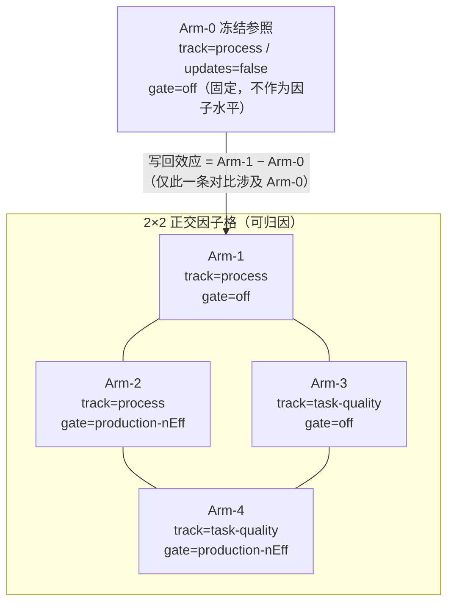
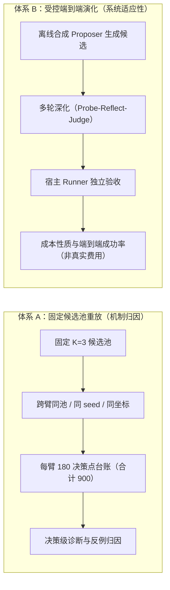
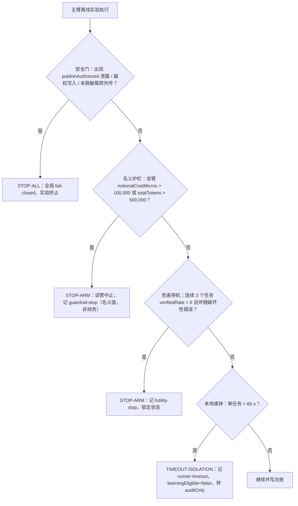

# PR-4A 五臂正交实验协议与统计分析计划（预注册 · V2）

# Pre-registration Protocol and Statistical Analysis Plan for the PR-4A Five-Arm Orthogonal Factorial Evaluation (V2)

| 项 | 值 |
| --- | --- |
| **文档类型** | **Pre-registered Experiment Protocol & Statistical Analysis Plan (SAP)**（预注册实验协议与统计分析计划） |
| **协议编号** | `PR4A-EVAL-PREREG-20261027-V2`（**取代** `PR4A-EVAL-PREREG-20261027-V1`） |
| **状态** | **Pre-registered / Sealed Draft, V2**（V1 的五臂定义**已否决**，不得用于任何实施或报告；本 V2 是唯一有效版本） |
| **V1 起草者** | experiment-engineer（t8，PR-4A 五臂实验工程；产出 `32ead8f80532dc059eff43d23158b1032c49ee80`） |
| **V2 修订者** | evaluation-implementer（t13「纠正五臂正交预注册与离线成本口径」） |
| **修订原因** | 见 §0。V1 把臂定义为「递进的架构消融」（含建议通道臂与单池混估臂），偏离 rev.3 的 **轨道 × 门控 2×2 正交**设计；并把 `micros`、`fake` 合成、本地 60 秒与统计检验力写成真实财务/已执行口径。V2 全文重写这两处根因，并逐节做一致性收敛。 |
| **团队归属** | `dsh-plugin-evo-rev3` |
| **代码基线** | HEAD `84a3d828ed2a27eef765c8b9c4950da4a9ee7287` |
| **执行受体** | 下游任务 `t10 [pr4a-run]`（实现并离线执行 PR-4A 五臂实验）——**必须以本 V2 为准** |
| **规范依赖** | ① `work/t1-baseline-audit.md`（基线审计与断言复验）；② ADR 0003（发布受体收口与 C2a 本地验证）；③ ADR 0004 C2b（双轨质量消费与 Dreamer 留出）；④ ADR 0004 C3（真实计量、取消、恢复与限额）；⑤ Captain 2026-10-27 裁定（R1: `P` 表为历史台账；R2: 只认 blob 原始字节指纹；R4: 复用生产通用保守门，禁止新建重复门；R5: H4 只是评测探针名，不等于生产门不存在） |
| **本轮边界** | **零真实付费调用、零发布、零部署、零 `commit`/`push`**。全部数字为离线受控运行/离线合成，见 §9 的成本口径与 §13 的合规红线 |

---

## 0. 版本沿革与本次修订原因（Revision Ledger）

本节存在的目的是让**任何下游读者都能判断自己读到的是哪一版、以及每一处改动的理由**，而不是为改动辩解。V1 的原始文本与摘要仍可从 t8 的完成回执与 blob `32ead8f80532dc059eff43d23158b1032c49ee80` 取回对照。

### 0.1 版本时间线

| 版本 | 日期 | 产出者 | 状态 | 说明 |
| --- | --- | --- | --- | --- |
| V1 | 2026-10-27 | experiment-engineer（t8） | **否决（Superseded）** | 五臂 = 冻结先验 / 纯过程单轨 / **建议通道** / **双轨单池混估** / C2b 完整选轨。把「架构递进消融」当作五臂，且含 `micros ↔ $` 的隐式换算 |
| V2 | 2026-10-27 | evaluation-implementer（t13） | **现行（Sealed）** | 五臂 = **Arm-0 冻结** + **轨道{process, task-quality} × 保守门{关闭, 生产 nEff}** 的 4 个正交格；建议通道与单池混估降级为**不进入五臂的探索性反例**（附录 A）；成本三态、统计方法、停止/退化判定全面重写 |

### 0.2 V1 → V2 的每一处修订及理由（**预注册修改必须留痕**）

| # | V1 的写法 | V2 的写法 | 修订理由（根因） |
| --- | --- | --- | --- |
| R-1 | 五臂为「冻结先验 / 纯过程单轨 / **建议通道** / **双轨单池混估** / C2b 完整选轨」的递进消融 | 五臂为 **Arm-0 冻结参照** + `轨道 × 门控` **2×2 正交**四格 | 任务要求严格恢复 rev.3 的**正交**设计。递进消融把「轨道」与「架构」两个因子混在同一条轴上，任何两臂之差都同时改变了多个因子，**不可归因**。正交设计才能估计轨道主效应、门控主效应与二者交互 |
| R-2 | 臂号写作 `Arm-1`…`Arm-5`，并把 Arm-1/Arm-2 定义为「严格禁止质量标签」 | 臂号统一写作 `Arm-0`…`Arm-4`，且**用轨道定义臂**（`Arm-0/1/2` 的轨道是 `process`），禁止用「禁止质量标签」来定义臂号 | 「禁止」是**轨道隔离的推论**，不是臂的身份。按禁止项编号会让读者以为质量标签是可变开关，而实际它是**臂的定义维度**。命名从 `Arm-1` 起也会让「冻结」臂缺位或与他文 `C0` 混淆 |
| R-3 | 全部五臂「初始快照 SHA-256 严格一致」，且隐含各臂快照等价 | 分协议声明：协议一（冷启动）全臂初始快照为空；协议二（跨任务）只要求 **process 分区逐字节一致**，质量记录**只允许**出现在 `Arm-3/Arm-4` | 若要求 `Arm-0/1/2` 的快照与 `Arm-3/4` 完全同构，就必然强迫基线臂承载质量记录——这既违反轨道隔离，也会在基线上引入质量信号。**不得要求 `Arm-0/1/2` 快照含质量记录** |
| R-4 | 假设表 `H1`–`H4` 预设「非劣 Δ ≥ −0.05 且困难任务 +0.10」「收复 −0.250，Δ ≥ +0.250」 | 删除全部带方向与量级的假设；改为**前定估计量**（主效应/交互/写回效应）表 | 预填正向结果与阈值等于 HARKing；且把「应当发生的量」写成判据会让「未发生」被读成失败。估计量只有**定义**，没有**预期符号** |
| R-5 | 主指标区间 = 「10,000 次 Bootstrap BCa」+「Wilcoxon 符号秩检验」，并称两者覆盖二值 | 主检验 = **精确/随机化配对方法**（二值用精确 McNemar/符号检验；率差用精确随机化反演区间）；Wilcoxon **明令禁止**用于二值主指标；Bootstrap 仅作敏感性分析 | Wilcoxon 假设对称连续分布并对结（ties）敏感；把 0/1 配对差喂给它会在大量零差/结处失效。12 个任务的 n 下，精确枚举（2¹² = 4096 个符号分配）完全可行，没有理由用渐近或错配方法 |
| R-6 | 「该套件可检测的最小标准效应量 Cohen's *d* ≈ 0.886」 | 改正为 `d ≈ 0.809`（n = 12, α = 0.05 双侧, 80% 检验力），并**明确标注这是闭式近似、不是已执行的功效分析**；另给出**精确枚举得到的**最小可检测胜率 0.869 | 0.886 是 n = 10 的值（`(1.96+0.8416)/√10 = 0.8859`），n = 12 应为 `(1.96+0.8416)/√12 = 0.8087`。更重要的是**禁止把未计算的检验力 d 冒充「已计算」** |
| R-7 | 成本直接写「微美元财务成本」与「**100,000 微美元（$0.10）**」上限 | 成本三态 `measured`/`estimated`/`unknown` + 占比；`micros` 是**记账单位不是美元**；`100,000 micros` 是**离线名义预算护栏**，不是真实财务上限；本地 60 秒**不是**远端费用上限 | 本轮是 fake 合成，**没有任何真实付费调用**，因此真实费用恒为 0，任何非零 micros 都只是名义值。「micros = $」是单位约定而非支出事实；把两者写成等价会让读者误以为存在一笔真实的 \$0.10 授权 |
| R-8 | 停止/判定规则互相覆盖：`非劣` 要求「退化任务数 = 0」，`退化/失败` 在「退化任务数 > 0」时即触发，`证据不足` 要求「CI 跨 0 且宽度 > 0.20」 | 拆成**四个互不覆盖的独立维度**（显著性 / 方向 / 退化状态 / 证据状态），**退化与证据不足可以并存**；只有「执行控制」有优先级，判定之间没有 | 原规则下「1 个任务退化 + 均值大幅为正」会同时被判为「非劣」和「退化/失败」，且「证据不足」与「优效」互斥——这是逻辑覆盖，不是严谨。判定必须正交 |
| R-9 | 主指标 VR = 12 任务均值，同时把「180 个决策点」当作分析对象 | 分析单位 = **任务**；轮次是**组内**深度维度，**不当作独立样本**；决策台账只作诊断，并声明其聚类结构 | 把 `(task, run, round)` 的 180 条当独立样本会虚增 n 约 15 倍、人为收窄区间。轮次是同一单元内的序贯深化，不是重复观测 |
| R-10 | 建议通道臂（`advice`）与单池混估臂（`NaiveMixed`）作为**正式臂**参与主假说族与 Holm 校正 | 二者移出五臂，只在**附录 A**作为探索性反例登记，**不进入**主比较族、Holm 族与任何五臂结论 | 它们不是 rev.3 的因子水平（不是「轨道」也不是「门控」），把非因子设计塞进正交族会破坏正交性与误差项 |
| R-11 | `enforceQualityTagBoundary(armId)` 按 `'Arm-1' \| 'Arm-2'` 的**编号**拦截 | `enforceArmTrackBoundary(arm, record)` 按**臂的轨道**调用生产同一谓词 `isOnLearningTrack` | 按编号硬编码的边界一旦臂重编号即静默失效；轨道谓词是生产既有实现（`src/jitrl/experience-store.ts:310`），复用可避免「文档里的检查」与「代码里的检查」分叉 |
| R-12 | 「180 条台账」被写成五臂共同产出 | 每臂 180 点，五臂合计 **900** 决策点；且声明台账的**全量数组**必须落盘为独立文件 | V1 的 180 是**单臂**的数量（12 任务 × 5 run × 3 round）。另据 `docs/reports/p61-eval-negative-result-explanation.md` §9（F3-b 更正），历史诊断 JSON 只保留了计数 + 4 条样例，**不是全量台账**——V2 要求全量落盘，禁止再用「计数当台账」 |

### 0.3 本次修订**没有**改动的内容（避免误读为全面重写）

以下条款经逐条比对**语义保持不变**，只做了措辞与锚点对齐：§1 的六条硬红线（除第 4 条按 R-2/R-11 改写）、§6 可信独立验收（宿主 runner / SHA-256 重算 / 六元组绑定 / 异常执行隔离）、§11 留出盲测协议、§4 的固定候选池与端到端双体系划分。

### 0.4 独立统计审计后的**实现澄清**（`PR4A-CLARIFY-20261028-A`，**不改变任何已锁定阈值**）

本节记录一次独立统计审计后对**实现**与**本协议**之间关系的核对结论。**没有任何一条阈值、判据、检验或停止规则被修改**：下列各条要么是协议已经写明、而实现此前**没有照做**的地方（已按协议修正实现），要么是协议给出判据但**未指定可观测定义**、需要明确口径以便复算的地方。逐条留痕的理由与 §0.2 相同：读者必须能判断「哪一侧改了」。

| # | 审计发现 | 本协议原文 | 处理（实现侧） | 性质 |
| --- | --- | --- | --- | --- |
| A-1 | 率型估计量被贴上二值检验的 p 值，主检验与 §8.3.1/§8.3.2 不一致 | §8.3.1 二值用精确 McNemar；§8.3.2 率型（$Y\in\{0,.2,\dots,1\}$）用精确配对随机化 | 实现改为按**系列的数据型别**选择主检验：率型 → 符号翻转；全二值 → McNemar。两个 p 值始终并列落盘，Holm 施加在**主检验 p** 上，并逐行记录 `primaryTest`/`binarySeries` | **修正实现以符合协议**（`§8.3.2`） |
| A-2 | 四维元组的 ③ 用了「某一臂相对冻结参照」的 DTS，判读对象错位 | §7.2 定义臂级 $\text{DTS}=\frac1N\sum_i \mathbf 1(\text{VR}_{k,i}<\text{VR}_{\text{ref},i})$；§8.5 ③ 说「DTS」但未写明是**哪个** DTS | §8.5 ③ 的判读对象是**估计量自身**，故实现改用逐任务估计量 $\Delta_i<0$ 的比例（与 §7.2 同一条「严格劣于」规则），并同时报告 $\Delta_i\le\text{NIM}$ 的**敏感度**读数与 §7.2 的臂级 DTS（仅描述）。§7.2 的臂级 DTS 仍然逐臂报告，未删除 | **明确口径**（§8.5 ③），未改阈值 $\text{DTS}_{\max}=3/12$ |
| A-3 | 判读区间用了不一致对胜出概率 $\pi$ 的 Clopper–Pearson 区间 | §8.5 ③④ 的判据写作「区间上界 $<\text{NIM}$」「区间宽度 $>0.50$」，但 §8.3.1 另行要求一个 CP($\pi$) 边际区间 | ③④ 一律读**估计量区间**（§8.3.2 的随机化反演，对均值差 $\mu$ 的网格反演）；CP($\pi$) 区间保留为**描述量**（`exactInterval`），并在报告中显式标注其**不参与**判读 | **明确口径**（§8.5 ③④），未改 $\text{NIM}$、$\text{MMI}$ 或宽度门槛 |
| A-4 | `effectiveReplication` 被写成常数 $L=5$ | §8.1.3 要求报告「每个任务组内 $L$ 次结果的唯一值个数」并在全常数时取 1 | 实现改为**由实测唯一值推导**：对**写回臂**取「每任务唯一值个数」的均值再跨臂取最大；全部写回臂的已分析任务均为常数时取**恰好 1**。冻结参照臂不参与该统计（它从不更新，其常数性属定义性质，纳入会**构造性**地把统计量压成 1） | **修正实现以符合协议**（`§8.1`） |
| A-5 | 门控关闭的两臂把挑战者强度落成 `null` | §3.4：门控关闭**仍然测量**（只是不拦截）；§3.2 把 `explorationAllowance` 钉 0 而不是跳过判定 | 五臂**无条件**调用生产 `decideReplacement` 并落盘 `challengerSupport/challengerNEff/challengerShrunkAdvantage/challengerCalibratedAdvantage` 四字段；门控开关只决定 `verdict` 能否改写被执行动作。`gate.applied` 只计**真正评估过**门控的决策点（门控开 **且** 提议偏离先验） | **修正实现以符合协议**（`§3.4/§3.2`） |
| A-6 | 未认证执行的写回路径可回落为 `process` 记录 | §6.3：未认证的恢复记录只能 audit-only，**不得**被静默降级为 `process` | 实现新增逐行 `writeDisposition`：质量臂遇到未认证执行一律 `audit-only-unauthenticated`（不写库、不降级）；同时把**质量邻域**改为只准入 `isAuthenticatedQualityRecord` 通过的记录，并断言未认证记录数为 0。过程臂的**执行级过程观测**（生产默认 `trustedSource=false`）单列披露，不计入违规 | **修正实现以符合协议**（`§6.3`） |
| A-7 | 轨道不变量只看最后一次写入的标量 `wroteTrack` | §5.2/§1 要求轨道隔离按**记录**成立 | 实现按**逐行**统计实际写入轨道与声明轨道是否一致（`learningTrackRows`），断言为「错轨行数 = 0」；标量 `wroteTrack` 仅作便利字段保留。验证器另从 JSONL 逐行**独立重算**该计数 | **修正实现以符合协议**（`§5.2`） |
| A-8 | 名义护栏与超时的语义边界可能被读成「超时即失败」 | §10.2 item 2/4；§6.4 要求超时/取消/基础设施异常统一 `learningEligible=false`、`auditOnly=true`，**不得**计为任务失败 | 护栏检查提前到**决策边界之前**（令牌阈值按 §10.2 同时生效）；被截断的执行标记 `censored`、**不带**布尔判定、从该任务分母中剔除并列入 `denominator-degraded`；未触发的路径逐条如实声明「未触发」及其原因 | **明确口径**（`§6.4/§10.2/§10.4`），未改 60 s 与 100,000 micros 的数值 |
| A-9 | 报告只绑定 `git rev-parse HEAD`，工作树为脏时无法定位真实执行代码 | §12.2 item 1 要求 JSON 含「代码基线 SHA、生成命令、种子」 | 报告新增 `codeProvenance` 区块：commit 对象 + `git describe --always --dirty` + **已跟踪脏文件**的 SHA-256 清单与摘要 + **实际执行模块**的逐个 SHA-256 与摘要（工作树字节）+ 复跑命令 | **增强可追溯性**；原 `codeBaseline` 字段保留不变 |
| A-10 | §12.2 item 3 的「12 行 × 10 个对比」表未落盘 | §12.2 item 3 要求逐任务差值表（12 行 × 10 个对比） | 报告与 JSON 落盘 12×10 的**两两**逐任务 Δ 表（10 列 = 10 个两两对照，属补充族）；§3.3 的**四个**受控估计量另以 12×4 表单独呈现，避免两族混表 | **补齐交付物**（`§12.2`）；未改变任何族成员 |
| A-11 | 危害停机的措辞与夹具能力不符 | §10.2 item 3：「连续 3 个任务 `verifiedRate` 由 1.00 跌至 0.00 **且伴随破坏性错误**」 | 实现按「连续 3 个任务 `verifiedRate = 0`」触发并记 `futility-stop`（标签 `early-stopped-for-harm`）；报告**显式披露**「伴随破坏性错误」这一半条件在本合成夹具中不可产生，故不作静默套用。本轮该路径**未触发** | **披露措辞差异**；触发条件未放宽（仍为连续 3 个零通过任务） |

> **不变式**：上述 A-1/A-4/A-5/A-6/A-7 全部是「实现此前偏离协议、现已回到协议」；A-2/A-3/A-8/A-11 是「协议给出判据但未写明可观测定义或措辞边界，现予明确并披露」；A-9/A-10 是补齐 §12.2 的交付物。**没有任何阈值、检验方法、停止规则或其优先级被修改**，故协议号仍为 `PR4A-EVAL-PREREG-20261027-V2`，§13 的签核清单不受影响。

---

## 1. 科学诚信硬红线（Scientific Integrity Invariants）

本协议在下游任何实验代码编写、执行或查看探针数据之前独立起草并密封锁定。为杜绝「先看数据后写假设（HARKing）」「留出集反向调参（Data Leakage / Peeking）」「主观包装正收益（P-hacking / Positive-Outcome Bias）」与「伪造不可复现数字」，确立以下七项不可动摇的硬红线。

1. **全面接纳客观中立结果（Embrace Zero / Negative / Inconclusive Results）**
   - 交付标准是**过程严密、数据可追溯、因果可归因**，不是算法必须产生正向超额收益；
   - 分析计划对四种结论完全对等：**正向改善**、**零差异**、**策略退化**、**证据不足**；
   - **严禁预设任何数值目标**：既不预设必须复现历史的 $-0.250$，也不预设必须达成任何正收益。测出什么，台账就记什么。

2. **最终留出集绝对盲测（Anti-Peeking Invariant）**
   - 留出集在候选策略生成前完成时序与任务分组切分，对策略选择与调参保持严格单向盲测；
   - **禁止**查看留出集评测数据来反向指导网格搜索、超参微调或规则修改；
   - 留出验证仅在最终获胜候选产生后触发**单次单向**判决。

3. **经验库与资源严格物理隔离（Physical Isolation）**
   - 每臂独立 `ExperienceStore` 实例、独立内存状态、独立持久化分区（见 §5.4）；
   - 严禁跨臂共享记录、交叉污染或隐式传递先验；
   - 跨臂使用**结构等价**的初始条件与**完全相同**的资源配额（§5）。

4. **轨道归属是臂的定义维度，不是开关（Track Is the Arm's Definition, Not a Permission Flag）**
   - 每一臂的检索/写回轨道由 §3.2 唯一定义：`Arm-0/1/2` 的轨道是 `process`，`Arm-3/4` 的轨道是 `task-quality`；
   - 轨道隔离由**生产既有谓词** `isOnLearningTrack(record, track)` 强制（`src/jitrl/experience-store.ts:309-312`）；`task-quality` 查询**只**保留显式声明该轨的记录，`process` 查询**永不**返回 `task-quality` 记录（`experience-store.ts:1173-1180`）；
   - 因此「`Arm-0/1/2` 不消费质量标签」是**轨道定义的推论**，不是它们的编号含义，也不是可通过配置翻转的权限；
   - **不得要求** `Arm-0/1/2` 的初始快照或运行期快照包含任何质量记录。

5. **统一受控的可信独立验收（Host-Owned Independent Verification）**
   - 全部五臂的主指标（`verified`）只能由宿主自有 runner 判定（`src/verification/host-runner.ts`）；
   - 交付物经 SHA-256 重算摘要并绑定六元组（`src/verification/attach.ts:104-108`、`:460-500`）；
   - 严禁任何臂以内部探索得分（过程步奖励、复合分数、KL 变化量）冒充验收通过证据。

6. **离线确定性与零真实付费调用（Offline Determinism & Zero Live Cost）**
   - 全部实验 100% 在本地离线沙箱、确定性合成夹具或受控 Fake Adapter 下运行；
   - 严禁发起未经授权的真实网络请求，严禁调用任何真实外部付费 LLM API；
   - 无法离线完成的端到端项目必须显式打标 `not-run (requires live API grant)`，严禁伪造运行结果。

7. **预注册修订必须留痕（Traceable Amendment）**
   - 任何对本协议的修改必须更新协议编号版本、在 §0 登记改动与理由，并保留被取代版本的可取回标识；
   - **禁止**在已执行或已查看数据之后静默修改判据、阈值、方法或臂定义。本轮 V2 的修订发生在**任何 PR-4A 数据产生之前**（工作树无 `work/pr4a-*` 产物，见 §13 的可复核断言）。

---

## 2. 历史证据及其证据等级（Historical Evidence & Its Epistemic Status）

### 2.1 历史负收益（−0.250）的原始口径

在 P6.1 阶段的公平评测中，针对固定候选池（$K=3$）、**协议一（同任务冷启动）**、`episodes=5 / rounds=3`，测得在线过程学习相对冻结的验证通过率差值为：

| 量 | 值 | 出处 |
| --- | --- | --- |
| $\Delta$(C3-online − C3-frozen) | $-0.250$ | `docs/reports/p6-fair-eval.md:95` |
| 95% 区间 | $[-0.417, -0.083]$ | `docs/reports/p6-fair-eval.md:95` |
| 胜/平/负（任务级） | 0 / 7 / 5 | `docs/reports/p6-fair-eval.md:95` |
| 退化任务比例 | 5/12 = 0.4167 | `docs/reports/p61-eval-negative-result-explanation.md:325-326` |
| 退化任务平均损失 | $-0.600$ | 同上 |
| 同分结论 $\Delta$(C3-online − C0) | 同为 $-0.250$ | `docs/reports/p6-fair-eval.md:103`（冷启动下 `C3-frozen ≡ C0`） |

$[-0.417, -0.083]$ 是**正态近似的可行性区间**：`scripts/eval/jitrl-eval-lib.ts:3633-3660` 的 `fairCompare` 用 `±1.96·se`，并在 `:3657` 自注「a feasibility interval on a 12-task synthetic suite, **not** a significance claim」。V2 **不**把该区间当作可推断的置信区间使用（§8.3 重算）。

### 2.2 机理诊断（保留，但明确其证据等级）

经 `scripts/eval/negative-result-diag.mjs` 的决策级诊断（180 个决策点 = 12 任务 × 5 run × 3 round）排查，负收益**不是**大模型能力不足，而源于选择规则与信息架构的系统性缺陷：

1. **动作键过度碎片化（Key Fragmentation）**：池槽位 patch 签名形状的微小差异把语义等价动作拆成独立键（如 `guardrails:append(1)` 与 `guardrails:append(1)#2`）；空组动作在 `unseenFallback='baseline'` 下获评 $A=0$，当受支持动作因部分惩罚处于 $A<0$ 时，零支持动作反转赢下 argmax。
2. **低支持错误改选（Low-support Deviations）**：早期轮次在 $\text{support} < 2$ 时激进偏离先验，破坏先验已达成的高覆盖。
3. **noop 正回报自举（Spurious Reward Bootstrapping）**：noop 改选在启发式过程标尺下仍可获得 $+0.30$ 回报，错误经验被写回并固化。
4. **过程信号与任务质量失配（Proxy Reward Mismatch）**：过程经验是高频连续代理信号，不能准确反映端到端真实测试集的二值断言结果。

> **证据等级声明（V2 新增）**：以上四条是**对一次离线合成重放的单例诊断**，其 180 条台账的全量数组只存在于脚本进程内——历史机读产物 `work/p61-e-diag.json` 仅含计数（180）+ 前 4 条样例（`docs/reports/p61-eval-negative-result-explanation.md:308-313`，F3-b 更正）。因此 §2.1–§2.2 **不能**作为「机理已被因果证明」的依据，只能作为**待检验的候选机理**驱动 §3 的因子选择。本协议不把任何一条机理写成已确立的因果结论。

### 2.3 为什么因子是「轨道」与「保守门」

上述机理恰好映射到 C2b 的两个正交机制：

- **轨道（track）**：机理 4 的候选修复是引入可信 `task-quality` 轨；机理 1/2/3 是过程轨自身的键与支持度问题。
- **保守门（conservative gate）**：机理 1/2 的直接候选修复是动作级证据门（低支持不得替换先验）。生产已存在该门：`src/jitrl/value-estimator.ts:459-487` 的 `conservativeAdvantage`（只认 $n_{eff}$、无证据则收缩为 0）与 `src/jitrl/replacement-policy.ts:117-210` 的 `decideReplacement`（`kept-prior` / `executed-exploration` / `executed-proposed`），接线在 `src/orchestrator.ts:2957`（估值）与 `:2965-2988`（门控与执行索引改写）。据 Captain 裁定 R4，**必须复用该门，禁止新建并行门**。

---

## 3. 五臂正交设计（Five-Arm Orthogonal Factorial Design）

### 3.1 设计矩阵

五臂 = **1 个冻结参照臂 + 2×2 正交因子格**。



| 臂 | 轨道（唯一的检索/写回轨道） | 动作级保守门 | 经验写回 | 动作选择通道 | 在因子设计中的角色 |
| --- | --- | --- | --- | --- | --- |
| **Arm-0** | `process` | **关闭**（固定；不作为因子水平） | **关闭**（`updates=false`，快照冻结） | 与 `Arm-1` 完全相同的生产决策内核路径 | **冻结参照臂**（参照格，不参与主效应估计） |
| **Arm-1** | `process` | **关闭**（`gate: off`，**仅限受控离线实验**，见 §3.4） | 开启（过程经验在线写回） | 生产决策内核（同 `Arm-0`） | 因子格 `(process, off)` |
| **Arm-2** | `process` | **开启：复用既有生产 $n_{eff}$ 保守门** | 开启（过程经验在线写回） | 生产决策内核 + `decideReplacement` 拦截 | 因子格 `(process, on)` |
| **Arm-3** | `task-quality` | **关闭**（`gate: off`，**仅限受控离线实验**，见 §3.4） | 开启（可信质量记录写回质量轨） | 生产决策内核 + 质量轨检索 | 因子格 `(quality, off)` |
| **Arm-4** | `task-quality` | **开启：同一生产 $n_{eff}$ 保守门**（与 `Arm-2` **同一实现、同一常量**） | 开启（可信质量记录写回质量轨） | 生产决策内核 + 质量轨检索 + `decideReplacement` 拦截 | 因子格 `(quality, on)` |

**设计要点（逐条可核对）**

1. **正交性**：`Arm-1/Arm-2` 只差门控；`Arm-3/Arm-4` 只差门控；`Arm-1/Arm-3` 只差轨道；`Arm-2/Arm-4` 只差轨道。任一相邻格之差**只改变一个因子**。
2. **无「禁止」编号**：本文档**没有**任何「Arm-N 被禁止做某事」的条款作为臂定义。`Arm-0/1/2` 读不到质量记录，是因为它们的轨道是 `process`（§1 红线 4）。
3. **`Arm-0` 的唯一性**：`Arm-0` 是参照格，**不**是第三个门控水平。其门控固定为关闭，且在 `Arm-1` 与之共享相同初始快照与相同选择通道的前提下，`Arm-1 − Arm-0` 隔离「过程写回」这一个差异。
4. **`Arm-2/Arm-4` 的门是同一个门**：两者必须调用**同一** `conservativeAdvantage` + `decideReplacement`（`value-estimator.ts:459`、`replacement-policy.ts:117`），常量取生产默认 `DEFAULT_MIN_EFFECTIVE_SAMPLES = 2`、`DEFAULT_ADVANTAGE_SHRINKAGE_K = 2`（`value-estimator.ts:405,407`）。禁止为任一臂另写门函数或调窄/调宽常量——否则两臂不可比且违反 Captain 裁定 R4。

### 3.2 逐臂的可执行规格（t10 实现依据）

| 字段 | `Arm-0` | `Arm-1` | `Arm-2` | `Arm-3` | `Arm-4` |
| --- | --- | --- | --- | --- | --- |
| `armId` | `Arm-0` | `Arm-1` | `Arm-2` | `Arm-3` | `Arm-4` |
| `track` | `process` | `process` | `process` | `task-quality` | `task-quality` |
| `queryLearningTrack` | `'process'` | `'process'` | `'process'` | `'task-quality'` | `'task-quality'` |
| `writesBack` | `false` | `true` | `true` | `true` | `true` |
| `writeTrack` | —（不写） | `'process'` | `'process'` | `'task-quality'` | `'task-quality'` |
| `conservativeGate` | `false` | `false` | `true` | `false` | `true` |
| `gateImplementation` | — | — | `conservativeAdvantage` + `decideReplacement` | — | **同上（同一函数、同一常量）** |
| `explorationAllowance` | `0`（固定） | `0`（固定） | `0`（固定） | `0`（固定） | `0`（固定） |
| `selectionChannel` | 生产内核 | 生产内核 | 生产内核 | 生产内核（质量轨邻域） | 生产内核（质量轨邻域） |
| `initialSnapshot` | 见 §5.2 | 见 §5.2 | 见 §5.2 | 见 §5.2 | 见 §5.2 |

**`explorationAllowance = 0` 的理由（关键对照控制）**：生产 `decideReplacement` 在「证据不足但仍有探索额度」时返回 `executed-exploration`（`replacement-policy.ts:190-197`），而探索额度默认就是 0（`src/orchestrator.ts:892` 的 `EXPLORATION_BUDGET = 0`，且需显式 `grantExplorationBudget`）。若各臂的探索额度不同，`gate: off` 与 `gate: on` 的差异会**同时**包含「是否拦截」与「是否允许预算探索」两个变化，从而不可归因。因此五臂**一律把探索额度钉为 0**：门控开 → 证据不足时 `kept-prior`（fail-closed 否决）；门控关 → 不拦截。这样门控因子只有一处语义差异。

### 3.3 前定估计量（主效应与交互）——**只定义，不预设方向**

设 $\bar{Y}_k$ 为第 $k$ 臂在 $n$ 个配对任务上的主指标均值，$\Delta_{k-j} = \bar{Y}_k - \bar{Y}_j$。

| 估计量 | 定义 | 允许的解释边界 |
| --- | --- | --- |
| **写回效应** $\theta_{\text{write}}$ | $\Delta_{1-0}$ | 仅「过程轨 + 门控关闭」下的**写回 vs 冻结**差异。**不得**外推为「在线学习有害/有益」的一般结论 |
| **轨道主效应** $\theta_{\text{track}}$ | $\tfrac{1}{2}\left[\Delta_{3-1} + \Delta_{4-2}\right]$ | 在门控两水平上的**平均**轨道效应。若交互不为 0，该平均值**不**等于任一门控水平下的轨道效应 |
| **门控主效应** $\theta_{\text{gate}}$ | $\tfrac{1}{2}\left[\Delta_{2-1} + \Delta_{4-3}\right]$ | 在轨道两水平上的**平均**门控效应。同上，交互不为 0 时不可单独解释 |
| **交互** $\theta_{\text{int}}$ | $\Delta_{4-3} - \Delta_{2-1}$ | 轨道与门控的**非可加性**。也可等价写作 $\Delta_{4-2} - \Delta_{3-1}$（2×2 平衡设计下二者相等，可用于一致性自检） |
| **与冻结的格内对比** $\Delta_{1-0}$ | 见上 | `Arm-0` **只**参与这一条对比；`Arm-0` 不进入任何主效应/交互的估计 |

> **不预填正向结果、不作独立因果结论**：
> 1. 上表**没有**任何符号、量级、阈值或「应当发生」的预期。任何一列出现正向、零或负值都是同等合法的结果。
> 2. 上述四个量是**同一批配对任务上的 2×2 因子观测的线性组合**，不是四次独立实验。存在交互时，$\theta_{\text{track}}$ 与 $\theta_{\text{gate}}$ 是**平均效应**，不能各自被单独解释为「轨道的因果主效应」；报告必须先看交互再看主效应（§8.4 的判读顺序）。
> 3. 本协议**不**声称任何机理（§2.2）会被证伪或证实；它只前定如何估计与如何报告不确定性。

### 3.4 门控语义与「门控关闭」的适用边界（**仅限受控离线实验**）

> **实现对照（§0.4 A-5）**：门控开关**只**决定 `decideReplacement` 的判定能否改写被执行动作；五条臂**无条件**
> 调用该生产函数并落盘 `challengerSupport` / `challengerNEff` / `challengerShrunkAdvantage` /
> `challengerCalibratedAdvantage`，因此「门控关闭」不等于「未测量」。`gate.applied` 只计**真正评估过**门控的
> 决策点（门控开 **且** 提议偏离先验），未偏离先验的行不计入。

**门控关 ≠ 关闭估计。** 生产路径在门控关闭时**仍然测量**挑战者强度，只是不拦截决策：

- `src/orchestrator.ts:2957` 无条件调用 `conservativeAdvantage(challengerEstimate)` 得到 `measured`；
- `:2965` 的 `if (this.conservativeGate)` 才进入 `decideReplacement`；
- 门控关闭时走 `:3004-3021` 的分支，只写「suggestion strength (gate closed)」诊断，**不改变执行索引**；
- 该分支的注释明确：「the gate is DISABLED by default… the frozen e2e baseline calibrates the online path WITHOUT interception」（`orchestrator.ts:2911-2914`）。

因此 `gate: off` 臂仍会产出 `nEff / support / shrunkAdvantage / calibratedAdvantage` —— 这些字段必须照常落盘，否则无法证明「门控是唯一差异」。

**适用边界（硬约束）**

1. `gate: off` **只允许**出现在本协议的受控离线实验中（`scripts/eval/` 下的离线确定性夹具 + 合成 proposer + Fake Adapter）；
2. `gate: off` **不是**生产配置，**不得**写入任何默认装配、配置默认值、README、状态页或发布说明；
3. 生产中该开关的既有约束必须保持：`deps.conservativeGate = true` 在非 `guarded-active` 模式会**抛错**（`orchestrator.ts:979-985`），默认模式是 `shadow`（`src/runtime/execution-profile.ts:81`），且默认装配不传该字段 ⇒ **默认装配下门为关闭**。这一事实说明「门控开」在本轮是**实验条件**而非既有生产行为，报告不得写成「生产已开启门控」；
4. `guarded-active` 模式会同时打开 `permissions.patch.allowed`（`execution-profile.ts:108`），而该权限会反向影响探索额度入参（`orchestrator.ts:2978-2979`）。由于五臂已把 `explorationAllowance` 钉为 0（§3.2），此耦合被消除；t10 **不得**用「切换 execution profile」来实现门控因子，而应**显式传入同一套门函数**，以免把模式切换的副作用混入因子。

### 3.5 与既有评测臂 ID 的映射（防止与历史资产混淆）

`scripts/eval/jitrl-eval-lib.ts:1964` 的 `FairArmId = 'C0' | 'C1' | 'C2' | 'C3-frozen' | 'C3-online' | 'C4'` 是 **P6 阶段的历史评测臂**，**不是** PR-4A 的臂。二者必须分开命名：

| PR-4A 臂 | 历史资产的**近似**对应 | 对应关系是否精确 | 说明 |
| --- | --- | --- | --- |
| `Arm-0` | `C3-frozen`（`lib:2015-2023`：`selection='kernel'`, `updates=false`，决策被记录但快照不变） | 结构对应 | 冷启动空快照下 `C3-frozen` 与 `C0`（`lib:1988-1995`，`selection='prior'`）在验证率上同值（`p6-fair-eval.md:95` vs `:103` 同为 −0.250）；V2 取「冻结但走内核」的形状，因为它与 `Arm-1` 共享选择通道 |
| `Arm-1` | `C3-online`（`lib:2024-2032`：`selection='kernel'`, `updates=true`） | 结构对应（历史上**没有**门控因子） | `Arm-1 − Arm-0` 应能复现 §2.1 的 −0.250 量级（作为**一致性自检**，不作为结论） |
| `Arm-2` | **无** | ✗ | 历史资产里没有「过程轨 + 生产门」臂 |
| `Arm-3` | **无** | ✗ | 历史资产里没有质量轨臂 |
| `Arm-4` | **无** | ✗ | 同上 |
| —（不属于五臂） | `C2`（advice 通道，`lib:2006-2014`）、`C4`（L1+L2，`lib:2033-2041`）、`C1`（random） | ✗ | 见附录 A：不作为五臂，不得进入主比较族 |

### 3.6 实施就绪度（诚实声明，禁止伪造）

`Arm-3` / `Arm-4` 依赖「质量轨检索 + 原子选轨」，而 ADR 0004 C2b 自述该能力在基线**不存在**：

- `src/jitrl/decision-kernel.ts` 对 `learningTrack` / `task-quality` **零命中**（唯一的 `quality` 命中在 `:661` 的注释「a quality signal」讨论取消/基础设施失败，与轨道无关）；
- L1/L2/L3 生产消费端硬编码 `learningTrack: 'process'`（`src/jitrl/index.ts:507`、`:609`；`experience-store.ts:327` 的 `PRODUCTION_LEARNING_TRACK`）；ADR 0004 C2b §2 明确「双轨分别检索与原子选轨在当前基线完全不存在」（`docs/adr/0004-c2b-*.md:42`）；
- 轨道的**原语**已存在（`isOnLearningTrack`、`ExperienceQuery.learningTrack` 过滤、`qualityProvenanceRegistry` 认证），但「分别检索 + 原子选轨」的装配不存在。

因此 t10 必须遵守以下**能力闸**：

1. 若能在**不触碰冻结面**的前提下，用既有原语在离线夹具内构造 `task-quality` 轨并完成「先选轨、后同轨 Q/V、再复用同一门」的装配 ⇒ 正常执行 `Arm-3/Arm-4`；
2. 若不能（例如需要修改 `src/jitrl/decision-kernel.ts`、`src/types/contracts.ts` 或 ADR 0002/0003 正文等冻结面），则 `Arm-3/Arm-4` **必须**报告为 `not-run (requires C2b dual-track implementation)`，并给出**阻塞点文件:行号**；
3. **绝对禁止**用临时字段、假 `learningTrack`、或把过程记录直接打标成质量记录来「凑出」质量轨。伪造质量标签同时违反 §1 红线 4 与 `quality-provenance.ts:66-90` 的认证语义（`isAuthenticated` 要求记录在**本轮**注册表中、且摘要重算一致、且 `verificationTrusted===1 && outcomeEligible===1 && learningEligible!==false`）。

---

## 4. 两套实验体系（Two Evaluation Regimes）

为兼顾**机制级归因**与**系统级适应性**，PR-4A 划分为两套数据完全隔离的体系：



### 4.1 体系 A：固定候选池离线重放（Fixed-Pool Replay）

1. **目的**：剥离生成模型的随机波动与候选池质量差异，专门检验「轨道」与「门控」两个因子在离散动作空间的作用及其交互。
2. **候选池规范**：
   - 固定候选数 $K = 3$（窄修改 A / 窄修改 B / 双表面合并 C）；
   - 跨全部五臂，在相同的 `(taskId, run, round)` 坐标上必须呈现**完全相同**的候选池指纹；
   - 池一致性由断言强制；任何跨臂池漂移立即中止该对比（不是「记录后继续」）。
3. **决策级诊断台账**：
   - **每臂** 12 任务 × 5 run × 3 round = **180** 条；五臂合计 **900** 条；
   - 每条必须含结构化字段：`armId`、`taskId`、`run`、`round`、`stateFingerprint`、`poolDigest`、`track`、`priorChoice`、`chosenChoice`、`deviated`、`executedIndex`、`gateReason`、`support`、`nEff`、`q`、`v`、`advantage`、`shrunkAdvantage`、`calibratedAdvantage`、`observedVerified`；
   - **严禁**写入任何敏感原始文本、代码补丁或 Prompt；
   - **全量数组必须独立落盘**（例如 `work/pr4a-ledger-Arm-3.jsonl`）并附 SHA-256；**禁止**只落计数或前若干条样例后自称「已保存台账」（§0.2 R-12）。
4. **离线确定性**：相同种子与参数下连续两次执行，指标与台账必须**逐字节一致**。该断言必须在 CI 里可复跑（同一进程内两次调用 + 摘要比对）。

### 4.2 体系 B：受控端到端演化（Controlled End-to-End）

1. **目的**：在开放搜索空间下评估机制对自主补丁生成、多轮反思、错误自愈与端到端交付的驱动，并**如实标注成本性质**。
2. **候选生成**：本阶段由**离线确定性合成规则**生成（非真实模型）；生命周期 `probeCandidate → evaluateSignals → recordExperience → compose → finalAttestation` 完整执行。
3. **成本观测**：按 §9 的三态口径记录；**本阶段不得出现「真实费用」字段取非零值**。
4. **离线安全红线**：若某项需要真实外部 API，必须显式标 `not-run (requires external API grant)`，不得擅自发起。

---

## 5. 对齐条件与物理隔离（Equalization & Isolation）

### 5.1 模型、任务、候选池（必须完全相同）

| 维度 | 对齐要求 | 本轮的实现形态 |
| --- | --- | --- |
| **模型** | 五臂使用**同一**模型标识与同一费率卡快照（`rateCardVersion` + `rateCardDigest` 冻结） | **零真实调用**：模型位是固定的离线合成 proposer + Fake Adapter（`scripts/eval/jitrl-eval-lib.ts:674` 的确定性 proposer、`:753` 的 mock branch executor）。任何「模型」标签必须写成 `synthetic-proposer/mock-adapter`，不得写成真实模型名 |
| **任务集** | 同一 12 任务、同一顺序、同一 split | `EVAL_TASKS`（`lib:177-298`）：`ci-fix` 4（ci-01..04）、`schema-migration` 4（mig-01..04）、`test-authoring` 4（test-01..04） |
| **候选池** | 同 `(taskId, run, round)` 下池指纹逐字节一致 | 冷启动体系 A 下由任务表固定 `K=3`；每坐标记 `poolDigest` |
| **初始条件** | 见 §5.2 | 冷启动全臂空快照；跨任务仅 process 分区同构 |
| **资源上限** | 同 `L`、`R`、同 `k`、同 `β`、同 `θ`、同超时、同并发 | 见 §5.3 |
| **验收** | 同一宿主 runner、同一 testSetId/envId 生成规则 | 见 §6 |

### 5.2 初始快照与轨道隔离（**分协议声明**）

**协议一：同任务冷启动（主协议，与 §2.1 的 −0.250 同口径）**

- 五臂初始经验库**全部为空**（0 记录），初始快照断言为 `empty`；
- 每臂在自己的 180 个决策点内积累**自己轨道**的记录：
  - `Arm-0`：不写回 ⇒ 快照始终为空，终态指纹 = 初始指纹（可在事后断言）；
  - `Arm-1/2`：只写 `process` 记录；
  - `Arm-3/4`：只写 `task-quality` 记录（来自宿主 runner 的可信回执，§6）。
- 由此 **`Arm-0/1/2` 的快照天然不含质量记录**——不是被禁止，而是其轨道不产生该类记录。**不得**为对齐而向它们注入质量记录。

**协议二：跨任务迁移（辅助协议）**

- 五臂共享**同一批** Donor 任务历史记录，且**只共享 process 分区**：
  $$\text{SHA-256}(\text{Snapshot}^{\text{proc}}_{\text{Arm-0}}) \equiv \text{SHA-256}(\text{Snapshot}^{\text{proc}}_{\text{Arm-1}}) \equiv \text{SHA-256}(\text{Snapshot}^{\text{proc}}_{\text{Arm-2}}) \equiv \text{SHA-256}(\text{Snapshot}^{\text{proc}}_{\text{Arm-3}}) \equiv \text{SHA-256}(\text{Snapshot}^{\text{proc}}_{\text{Arm-4}})$$
- `Arm-3/Arm-4` 额外获得**同一批**可信质量记录分区 $\mathcal{Q}$，且
  $$\text{SHA-256}(\mathcal{Q}_{\text{Arm-3}}) \equiv \text{SHA-256}(\mathcal{Q}_{\text{Arm-4}})$$
- **强约束**：$\text{Snapshot}_{\text{Arm-0/1/2}}$ **不含** $\mathcal{Q}$ 的任何记录，且其 process 分区与 `Arm-3/4` 的 process 分区**逐字节相同**。等价地，`Arm-3/4` 快照 = 同构 process 分区 ∪ 同一质量分区，**不是**「另一份不同的 process 分区」。
- **禁止**把「全臂快照完全同构」写成对齐要求：那会迫使基线臂承载质量记录。

### 5.3 资源上限与超时（对齐 + 语义边界）

| 参数 | 值 | 语义 |
| --- | --- | --- |
| 每任务执行次数 $L$ | 5 | 同一任务内的重复执行（见 §8.1 的重复性检查） |
| 每执行深化轮数 $R$ | 3 | **组内**序贯深化，不是独立样本 |
| 任务数 $N$ | 12 | 配对分析单位数 |
| 探索温度 $\beta$ | 1.0 | 内核超参 |
| 检索近邻上限 $k$ | 10 | 内核超参 |
| Jaccard 相似度阈值 $\theta$ | 0.3 | 内核超参 |
| 保守门最低有效样本 $n_{\min}$ | 2（生产默认 `DEFAULT_MIN_EFFECTIVE_SAMPLES`） | 复用生产常量，禁止为本实验改值 |
| 保守门收缩常数 $K$ | 2（生产默认 `DEFAULT_ADVANTAGE_SHRINKAGE_K`） | 同上 |
| 探索额度 `explorationAllowance` | **0**（五臂固定） | 见 §3.2 的对照控制理由 |
| 并发席位 | 1（确定性串行） | 消除并发调度差异 |
| 单次调用本地超时 | 10 s | **本地墙钟**护栏，见下 |
| 单任务本地墙钟上限 | 60 s | **本地墙钟**护栏，见下 |

> **60 秒的语义边界（V2 修正）**：60 s 是**离线夹具的本地墙钟护栏**，用于防止死循环与挂起，并作为「是否标记 `runner-timeout`」的判据。它**不是**远端费用上限，也**不能**用来界定价外支出：
> - 远端计费按 token（以及按 Provider 语义的 cache/reasoning）计价，与本地墙钟无函数关系；
> - 一个本地 60 s 的截止时间**不能**阻止远端已经发生的计费（请求一旦发出，费用由 Provider 侧结算）；
> - 因此「60 s 内 ⇒ 不超预算」是**无效推理**，本协议禁止如此表述。

### 5.4 经验库物理隔离与因果截断

1. **物理分区**：每臂独立 `ExperienceStore` 实例 + 独立存储路径（如 `work/exp/Arm-3.jsonl`），**禁止**跨臂指针共享或复用同一文件。
2. **强因果时序截断**：查询必须传 `before: currentExecutionClock`，禁止任何决策点看到该时刻之后写入的记录。
3. **执行次序伪随机置换**：`(taskId, arm)` 的执行次序由固定种子洗牌，消除缓存/内存碎片/先后顺序的系统偏差；洗牌种子必须落盘，且五臂共享同一次洗牌结果（保证每个任务在五臂上落在相同的相对位置）。
4. **跨臂零共享断言**：运行结束后必须断言五臂的记录 id 集合两两不交，且任一臂的记录数不等于其他臂的记录集合并集大小。

---

## 6. 可信独立验收（Trusted Ground-Truth Verification，不可协商）

### 6.1 验收标尺与学习信号彻底解耦

- 最终 `verified` 只能由宿主在独立受控环境运行测试集决定（`src/verification/host-runner.ts:79` 的 `createHostOwnedVerificationRunner`）；
- 验收结果严格二值：`passed → 1` / `failed → 0`；
- 严禁各臂以内部自评分数、启发式奖励或策略收敛度代替验收。

### 6.2 交付物密码学绑定

1. **摘要重算**：宿主用 `node:crypto` 对交付物重算 SHA-256（64 hex），强制覆盖 `deliverable.contentHash`（`src/verification/attach.ts:277`）；
2. **六元组绑定**：$\langle \text{taskId}, \text{testSetId}, \text{envId}, \text{runId}, \text{trajectoryId}, \text{role} \rangle$（字段清单见 `attach.ts:101-110`）；任一不匹配即触发对应原因码并剔除——实测拒绝码包括 `binding-mismatch`（`:465-476`）、`run-mismatch`（`:477-479`）、`test-set-mismatch`（`:480-486`）、`env-mismatch`（`:487-493`）、`digest-mismatch`（`:494-500`）；
3. **空 checks / 缺件拦截**：回执必须携带非空 `checks`（`attach.ts:88-89`），artifact 缺失以 `artifact-missing` fail-closed。

### 6.3 质量记录的可信来源（`Arm-3/Arm-4` 的写入前提）

> **实现对照（§0.4 A-6/A-7）**：逐行 `writeDisposition` 记录该执行是 `written` 还是 `audit-only-*`；**质量臂**遇到
> 未认证执行一律 `audit-only-unauthenticated`（不写库、不回落为 `process`）。检索侧另有**质量邻域断言**：
> 质量臂只准入 `isAuthenticatedQualityRecord` 通过的记录，未认证记录数必须为 0。轨道不变量按**逐行**统计
> （`learningTrackRows`，错轨行数 = 0），不依赖最后一次写入的标量 `wroteTrack`。

`task-quality` 记录必须满足 `quality-provenance.ts:66-90` 的全部条件：

- `learningTrack === 'task-quality'`；
- 在本轮**内存注册表**中已注册（`qualityProvenanceRegistry`，进程重启即清空）；
- 内容摘要重算一致（`computeQualityRecordDigest`，覆盖 id/level/track/actionKey/reward/state/关联/上下文）；
- `rewardSources.verificationTrusted === 1 && rewardSources.outcomeEligible === 1`，且 `learningEligible !== false`。

**不得**用文本标签或未认证的持久化记录提升为 `task-quality`；未认证的恢复记录只能 audit-only，**不得**被静默降级为 `process`。

### 6.4 异常执行与超时隔离

依据 ADR 0003 §5.1 与既有基线，超时（`runner-timeout`）、取消（`aborted/cancelled`）与基础设施异常（`infrastructure_error`）必须统一标记：

$$\text{learningEligible} = \text{false},\quad \text{forceAuditOnly} = \text{true},\quad \text{reward} = 0$$

**严禁**把超时与取消伪报为任务失败并计入质量负样本（防止误惩罚探索路径）；其数据只进入审计流。

---

## 7. 指标体系（Metrics）

### 7.1 主指标（Primary）

**任务可信验证通过率（Verified Rate）**，按**任务**聚合：

$$\text{VR}_{k,i} = \frac{1}{L}\sum_{\ell=1}^{L} \mathbf{1}\!\left(\text{episode } \ell \text{ of task } i \text{ in arm } k \text{ is host-verified}\right),\qquad \bar{Y}_k = \frac{1}{N}\sum_{i=1}^N \text{VR}_{k,i}$$

- 配对分析的**基础单位是任务 $i$**（$N = 12$）；
- **轮次 $R$ 是任务内序贯深化**，只影响该 episode 的最终 `verified`，**不**进入样本量；
- 二值化口径：$Y_{k,i} \in \{0, 0.2, 0.4, 0.6, 0.8, 1\}$（$L=5$）。若所有任务的 $L$ 次执行结果完全相同（组内方差为 0），则设计**退化为二值**，此时的推断只用 §8.3 的二值精确方法，并在报告中显式写 `effectiveReplication = 1`。

### 7.2 次要指标（Secondary）

| 指标 | 定义 | 备注 |
| --- | --- | --- |
| 平均表面覆盖率 $\text{MC}$ | 补丁对必需修改表面（`guardrails`, `tool_guidance`, `skills`）的命中比例，$[0,1]$ 连续 | 唯一允许用 Wilcoxon 的对象（连续、可近似对称），且仍标为**次要** |
| 最终轮相对收益 | $\text{Coverage}_{R-1} - \frac{1}{R}\sum_{r=0}^{R-1}\text{Coverage}_r$ | 判断深化是变好还是退化 |
| 改选率 | 实际决策 ≠ 先验最高置信动作的决策点比例 | 行为指标，非质量指标 |
| 策略漂移 $D_{KL}$ | $\sum_a \pi_{\text{adj}}(a)\ln\frac{\pi_{\text{adj}}(a)}{\pi_{\text{prior}}(a)}$ | 只反映改变幅度；非零**不等于**变好 |
| 有效样本量 $n_{eff}$ | 动作级 Kish 有效样本量 | 证据充沛度 |
| 退化任务比例 $\text{DTS}$ | $\frac{1}{N}\sum_i \mathbf{1}(\text{VR}_{k,i} < \text{VR}_{\text{ref},i})$ | 描述性；判读见 §10 |
| 门控介入分布 | `kept-prior` / `executed-proposed` 计数与 `gateReason` 分布（`implicit-zero-advantage` / `min-support` / `exploration-budget`） | **证明门控确实生效**的必要证据；`Arm-2/Arm-4` 若该分布为空，视为门控未接线的阻塞缺陷 |

### 7.3 成本指标

见 §9（真实 / 估计 / 未知三态与占比）。

---

## 8. 统计分析计划（Statistical Analysis Plan, SAP）

### 8.1 分析单位、重复性与「不把多轮当独立样本」

1. **分析单位 = 任务**（`taskId`），$N = 12$。所有主推断都在这个 $n=12$ 的配对样本上做。
2. **轮次不是样本**：`(taskId, run, round)` 的 180 个决策点是**诊断**对象，不是推断样本。任何按 180（或 900）计算标准误、自由度、p 值的做法**一律禁止**——那会把有效 n 虚增 15–75 倍。
3. **重复性检查（前定，必须在看主结果前执行并报告）**：本轮 runner 是确定性夹具，同一任务的 $L=5$ 次执行可能完全同值。必须报告：
   - 每个任务组内 $L$ 次结果的唯一值个数；
   - 全表组内方差为 0 的任务数 / 12；
   - 若全部为 0，则 $\text{effectiveReplication}=1$，此时**只**报告二值分析（§8.3.1），并在标题与结论句中写明「有效重复 = 1，$L=5$ 仅证明确定性，不构成 5 个独立观测」。
4. **缺失与排除**：`learningEligible=false`（超时/取消/基础设施）的执行按 §6.4 只进审计流，**不**计为失败负样本；其可能改变某任务的 $L$（分母），因此必须报告每任务实际可用 episode 数，并对「可用 episode 数 < L」的任务列入 `denominator-degraded` 清单。

### 8.2 配对差值与描述量

对任意两臂 $k, j$：

$$\Delta_i = Y_{k,i} - Y_{j,i},\qquad \bar{\Delta} = \frac{1}{N}\sum_{i=1}^N \Delta_i,\qquad s_\Delta = \sqrt{\frac{1}{N-1}\sum_{i=1}^N(\Delta_i - \bar{\Delta})^2}$$

同时报告**胜/平/负**计数（$w$ / $t$ / $\ell$，$w + t + \ell = N$）与**不一致对数** $m_{\text{disc}} = w + \ell$。$m_{\text{disc}}$ 是所有精确配对检验的实际信息量，**必须**与点估计并列报告——$m_{\text{disc}}$ 很小的「显著」与 $m_{\text{disc}}$ 很小的「不显著」都不该被过度解读。

### 8.3 不确定性：精确 / 随机化方法优先（**禁止机械套 Wilcoxon**）

#### 8.3.1 二值主指标（或 §8.1 退化后的二值情形）

- **主检验：精确 McNemar（= 不一致对上的精确符号检验）**
  在 $H_0$：不一致对的两个方向等概率（$\pi = 1/2$）下，
  $$p_{\text{two-sided}} = \min\!\left(1,\; 2\sum_{u=w}^{m}\binom{m}{u}2^{-m}\right)$$
  对 $m_{\text{disc}} \le 20$ 可精确枚举（$m_{\text{disc}}=12$ 时共 $2^{12} = 4096$ 个符号分配，直接穷举即可）。报告 $w, \ell, m_{\text{disc}}, p$。
- **前定拒绝边界表**（α = 0.05 双侧，精确枚举所得，可由 §13 命令复算）：

  | 不一致对数 $m_{\text{disc}}$ | 单方向胜出数需 ≥ | 对应精确双侧 $p$ |
  | --- | --- | --- |
  | 6 | 6 / 6 | 0.0313 |
  | 8 | 8 / 8 | 0.0078 |
  | 9 | 8 / 9 | 0.0391 |
  | 10 | 9 / 10 | 0.0215 |
  | 11 | 10 / 11 | 0.0117 |
  | 12 | 10 / 12 | 0.0386 |

- **区间**：报告「配对比例差」的**精确随机化反演区间**（以同一精确检验反转得到），或 Newcombe 配对差区间；**禁止**用 $\pm 1.96\sqrt{\hat p(1-\hat p)/n}$ 之类的单样本正态公式冒充配对差区间（忽略配对相关性会系统性高估方差）。同时给出两臂各自的精确（Clopper–Pearson）边际比例区间，作为**边际**描述而非差值推断。

#### 8.3.2 率型指标（$Y \in \{0, .2, \dots, 1\}$）与连续次要指标

- **主检验：配对随机化（符号翻转）检验**
  在 $H_0$：$\Delta_i$ 的符号对称下，枚举全部 $2^{N} = 4096$ 个符号分配，计算
  $$p = \frac{1}{2^N}\sum_{s \in \{\pm 1\}^N}\mathbf{1}\!\left(\left|\sum_i s_i \Delta_i\right| \ge \left|\sum_i \Delta_i\right|\right)$$
  这是**精确**检验（无分布假设、对结稳健），$N=12$ 时穷举瞬时完成。
- **区间**：以同一检验**反演**得到区间（把 $\mu$ 在网格上扫描，保留不被拒绝的 $\mu$ 集合）。若实现成本高，允许退化为配对 Bootstrap（固定种子、10,000 次）作为**敏感性**结果，并在报告中标注「敏感性，非主区间」。BCa 在 $n=12$ 时加速常数不稳定，必须同时给出百分点法与 BCa 两个结果，不一致时以**更宽的**为准。
- **Wilcoxon 符号秩检验**：**仅**允许用于**连续**次要指标（如 $\text{MC}$、延迟），且必须报告结（ties）处理方式与零差个数；**明确禁止**用于二值主指标、$R=3$ 轮台账、或任何 0/1/0.2 台阶数据。

#### 8.3.3 显示精度与可复算性

> **实现对照（§0.4 A-1）**：主检验按**系列的型别**选择——率型（$Y\in\{0,.2,\dots,1\}$）走 §8.3.2 的精确配对
> 随机化（符号翻转），**只有**全二值系列才走 §8.3.1 的精确 McNemar；两个 $p$ 值并列落盘，Holm 校正施加在
> **主检验 $p$** 上。报告与 JSON 逐对比给出 `primaryTest`、`binarySeries`、`pPrimary`、`pRaw`、`pSignFlip`。

所有 $p$ 值、区间端点、效应量必须**同时**给出：算法名、随机种子（若含随机化）、枚举空间大小（若为精确法）、以及一条可复跑命令。禁止只给小数。

### 8.4 主效应与交互的估计与前定宽度预算

对 §3.3 的四个估计量，逐任务计算组合量后**再**做配对随机化检验（先组合、后检验，保证配对结构不被破坏）：

- 写回效应：$d_i = Y_{1,i} - Y_{0,i}$
- 轨道主效应：$d_i = \tfrac{1}{2}[(Y_{3,i}-Y_{1,i}) + (Y_{4,i}-Y_{2,i})]$
- 门控主效应：$d_i = \tfrac{1}{2}[(Y_{2,i}-Y_{1,i}) + (Y_{4,i}-Y_{3,i})]$
- 交互：$d_i = (Y_{4,i}-Y_{3,i}) - (Y_{2,i}-Y_{1,i})$

**前定宽度预算（在数据之前写下，用于事先承认可检测性上限）**：设单臂任务级率的标准差为 $\sigma$，则 95% 正态近似半宽为

| 估计量 | 逐任务组合量的方差（模型） | 半宽 |
| --- | --- | --- |
| 写回效应（单一配对差） | $\sigma^2$ | $1.96\sigma/\sqrt{12} \approx 0.566\sigma$ |
| 主效应（两个配对差的平均） | $\tfrac{1}{2}\sigma^2$（忽略二者的协方差） | $1.96\sigma/\sqrt{24} \approx 0.400\sigma$ |
| 交互（两个配对差之差） | $2\sigma^2$（独立格上界） | $1.96\cdot\sqrt{2}\sigma/\sqrt{12} \approx 0.800\sigma$；若两个配对差高度相关则该值收缩，下界接近 0 |

以 $\sigma = 0.5$（单个二值任务可取得的最大标准差）为例：写回效应半宽 $\approx 0.283$、主效应 $\approx 0.200$、交互 $\approx 0.400$（独立上界）。**结论**：在本设计下，**交互项基本不可解释为推断结论**，只能作描述性报告；主效应即使存在也需 $|\theta| \gtrsim 0.2$ 才可能被区间排除 0。此表是**事先承认**，不是事后辩解。

**判读顺序（前定）**：① 先报告交互 $\theta_{\text{int}}$ 与其宽度；② 若交互区间在实用意义上几乎覆盖整个效应域（即无法排除非可加性），则**不得**单独把 $\theta_{\text{track}}$ / $\theta_{\text{gate}}$ 解释为因子主效应，只能报告「在 $2\times2$ 四格上的观测模式」；③ 写回效应 $\Delta_{1-0}$ 独立报告，且明确它只对应「过程轨 + 门控关」这一格。

### 8.5 决策带（MMI / NIM）与**四维判读元组**

> **口径澄清（§0.4 A-2/A-3，不改变任何阈值）**：③ 的 $\text{DTS}$ 是**被检验估计量自身**的逐任务退化比例
> （$\#\{i:\Delta_i<0\}/N$，与 §7.2 同一条「严格劣于」规则作用于估计量而非臂）；④ 的区间宽度取自**该估计量的
> 随机化反演区间**（§8.3.2），**不是** §8.3.1 的 $\text{CP}(\pi)$ 区间——后者是不一致对胜出概率的边际描述，
> 已在实现中作为独立字段保留但**不参与**本节判读。§7.2 的臂级 DTS 仍逐臂报告，但**不得**用作本节的判读输入。

V1 把「优效 / 非劣 / 退化 / 证据不足」做成互斥标签，导致逻辑覆盖（§0.2 R-8）。V2 改为：**决策带只作用于估计值，判读由四个独立维度组成一个元组**。

**决策带（前定，作用于点估计 $\bar\Delta$ 与精确区间）**：

$$\text{MMI} = +0.10,\qquad \text{NIM} = -0.05,\qquad \text{DTS}_{\max} = 0.25 \;(\text{即 } 3/12 \text{ 个任务})$$

- MMI/NIM/DTS 上限是**判读带**，不是「必须达成」的目标；未落入任何有利带是**合法结果**。
- V1 的 `DTS ≤ 5%`（12 任务 ⇒ 只允许 0 个退化）在 $N=12$ 上等价于「0 个任务退化」，与「任一任务退化即判失败」互为镜像，会把「1 个任务退化 + 11 个任务改善」判成失败。V2 改为 $\text{DTS}_{\max} = 3/12 = 0.25$，并**同时**要求报告逐任务差值，使读者能自行判断退化集中在哪个家族。

**四维判读元组（**互不覆盖、可并存**）**：

| 维度 | 取值 | 判据（前定） |
| --- | --- | --- |
| ① `significance` | `reject` / `not-reject` | §8.6 Holm 校正后的精确/随机化检验结论 |
| ② `direction` | `+` / `0` / `−` | $\bar\Delta$ 的符号（$|\bar\Delta| < 10^{-9}$ 记 `0`） |
| ③ `degradationStatus` | `degraded` / `not-degraded` / `undetermined` | `degraded`：$\text{DTS} > \text{DTS}_{\max}$ **或** 区间上界 $< \text{NIM}$。`not-degraded`：$\text{DTS} \le \text{DTS}_{\max}$ **且** 区间下界 $\ge \text{NIM}$。其余为 `undetermined` |
| ④ `evidenceStatus` | `sufficient` / `insufficient` | `insufficient`：$m_{\text{disc}} < 8$ **或** 区间宽度 $> 0.50$（前定宽度门槛）。否则 `sufficient` |

> **符号约定（避免与 §8.6 冲突）**：本节的 $m_{\text{disc}}$ 是**不一致对（discordant pairs）数** $= w + \ell$；§8.6 的 $m$ 是**受控族的假设个数** $= 4$。二者含义不同，报告与代码中必须分别命名（`discordantPairs` / `familySize`），**禁止**混用同一个变量名。

> **关键性质（V2 的核心修正）**：
> - ③ 与 ④ **可以同时为**「退化 + 证据不足」。这是最需要被如实报告的常见组合（少数任务变差、但 $n=12$ 无法定论），任何「因为有退化所以证据充分」或「因为证据不足所以没有退化」的推理都被禁止。
> - ②③④ 都不依赖 ①：不显著的负向点估计**仍然**是 `direction = −`，不得改写成「无差异」。
> - 「未达成 MMI」**不是**失败；「达成 MMI 但 ① 为 not-reject」也**不是**成功，只能报 `direction=+, significance=not-reject`。
> - 报告必须给出**元组**，禁止压成单一标签。

### 8.6 多重比较

**受控族（Holm–Bonferroni，FWER ≤ 0.05）**，$m = 4$ 个**前定**对比：

1. $\theta_{\text{write}} = \Delta_{1-0}$
2. $\theta_{\text{track}}$
3. $\theta_{\text{gate}}$
4. $\theta_{\text{int}}$

$$p_{(1)} \le \frac{\alpha}{4},\quad p_{(2)} \le \frac{\alpha}{3},\quad p_{(3)} \le \frac{\alpha}{2},\quad p_{(4)} \le \alpha$$

**必须声明**：附录 A 的反例（建议通道 / 单池混估 / random / L1+L2）**不在此族内**，其 $p$ 值不得用来支撑任何五臂结论，也不得与上表合并校正后宣称「整体显著」。

**探索性族（BH FDR，$q \le 0.10$）**：全部次要指标、任务家族分层、复杂度分层、决策点诊断的 $q$ 值单独汇报，**与**受控族分开成表。

### 8.7 检验力与最小可检测效应（诚实声明：**闭式近似，不是已执行的功效分析**）

- 现实：$N = 12$ 个合成任务。
- **最小可检测效应（正态近似，α = 0.05 双侧，$1-\beta = 0.80$）**：
  $$d_{\min} = \frac{z_{1-\alpha/2} + z_{1-\beta}}{\sqrt{N}} = \frac{1.9600 + 0.8416}{\sqrt{12}} \approx 0.809$$
  （V1 写的 0.886 是 $N=10$ 的值 $\frac{2.8016}{\sqrt{10}} = 0.8859$；V2 更正。）
- **精确符号检验的功效（精确枚举，非近似）**：在 $m_{\text{disc}}=12$ 个不一致对、双侧 $\alpha = 0.05$ 下，

  | 真实单方向胜出概率 $\pi$ | 检验力 |
  | --- | --- |
  | 0.70 | 0.2530 |
  | 0.75 | 0.3907 |
  | 0.80 | 0.5584 |
  | 0.85 | 0.7358 |
  | 0.90 | 0.8891 |

  达到 80% 检验力所需的最小胜出概率 $\pi^\* \approx 0.869$。**换言之：只有当某一臂在约 87% 的不一致对上占优时才可能达到常规功效**——这在本设计下属于极强效应。
- **结论边界**：
  1. 本套 12 任务评测提供的是**机制可行性与决策级归因证据**，**不是**生产规模的统计显著性或外推证明；
  2. **禁止**把 $d_{\min} = 0.809$ 或 $\pi^\* = 0.869$ 说成「本实验已计算并达到了功效」——它们是**事先的可检测性上限**；
  3. **禁止**把不显著读成「无效应」，也禁止把显著读成「效应很大」；
  4. 明确禁止把 12 个合成任务的结论过度外推为通用生产结论。

### 8.8 分层与交互的正确定位

1. **任务家族分层**：`ci-fix`（ci-01..04）/ `schema-migration`（mig-01..04）/ `test-authoring`（test-01..04）。每层 $n = 4$，**仅描述性**；禁止在 $n=4$ 上做显著性宣称。
2. **复杂度分层**：单表面 vs 多表面任务；同上，描述性。
3. **与 §3.3 的「交互」不是同一概念**：§3.3 是**因子交互**（可推断，受控族内）；本节是**亚组异质性**（探索性，BH 族内）。二者不得混称「交互作用显著」。

---

## 9. 成本口径：真实 / 估计 / 未知（Cost Semantics）

### 9.1 单位与语义（三条硬约束）

1. **`micros` 是记账单位，不是美元**。代码约定 $1\ \text{USD} = 1{,}000{,}000\ \text{micros}$（`src/ledger/types.ts:83`、ADR 0004 C3 §8.2），这只是把浮点金额换成整数以避免舍入误差的**单位约定**。一个 `micros` 数值**不自动**等于「已发生的一笔美元支出」：
   - 若它来自**未授权**的费率卡（如本轮的离线 fixture 费率卡），它是**名义值（notional）**；
   - 只有「真实 Provider 账单 + 真实结算」才使该数值具备货币意义。
2. **本轮是 fake 合成，真实费用恒为 0**。`Fake Adapter` 不产生任何真实调用，因此：
   - `liveCalls = 0`、`incurredRealUsd = 0.00` 必须作为**硬断言**写入报告；
   - **禁止**报告任何「真实费用」为非零值；
   - 任何非零金额字段必须显式带前缀 `notional`（例如 `notionalCostMicros`），并注明所用费率卡 `rateCardVersion` + `rateCardDigest`。
3. **三态精度必须逐项标注**（ADR 0004 C3 §B-3）：

| 状态 | 触发条件（生产语义） | 本轮（fake 合成）的预期状态 |
| --- | --- | --- |
| `measured` | 全部字段实测且语义显式声明 | **不可能出现**。Fake Adapter 无 Provider telemetry ⇒ 无法「实测」 |
| `estimated` | 存在估算字段、无未知、语义已声明 | 仅当显式声明 `CountingSemantics` 且用分词器/渲染估算时成立。本 harness **无 tokenizer**（`lib:2178` 的 `FAIR_TOKEN_ESTIMATOR = 'chars/4 over the exact rendered prompt text (no tokenizer in this harness)'`），故 token 数只能是 `estimated` |
| `unknown` | 任一核心字段未知，或**未声明语义**（强制降级），或只给 `actualCost=0` 而无 usage payload | **本轮最可能的真实状态**。降级后必须施加严格 $>0$ 的保守地板，差额计入 `conservativeSurchargeMicros`（`src/ledger/pricing.ts:136-145`；`aggregatePrecision` 在 `pricing.ts:23-43`：未声明语义 ⇒ `'unknown'`，任一指标 unknown ⇒ `'unknown'`） |

> **必须诚实报告的一个后果**：由于本轮 `unknown` 会触发保守地板，离线台账里会出现**非零的、被地板抬高过的** `totalCostMicros`。这些数字是**保守上界的记账值**，不是支出、也不是对 Provider 价格的估计。报告必须把「地板附加费」与「基础计算值」分开列出，禁止合并成一个「成本」数字。

### 9.2 成本报告表结构（t10 强制格式）

必须逐臂给出下表，且**占比必须有明确分母**（分母三选一，且在表头写明）：

| 臂 | 决策点数 | 调用数（模型调用尝试） | `measured` 决策数 / 占比 | `estimated` 决策数 / 占比 | `unknown` 决策数 / 占比 | `notionalCostMicros` | `conservativeSurchargeMicros` | `liveCalls` | `incurredRealUsd` |
| --- | --- | --- | --- | --- | --- | --- | --- | --- | --- |
| `Arm-0` | 180 | … | 0 / 0.0% | …% | …% | 名义值 | 单独列出 | 0 | 0.00 |
| `Arm-1` | 180 | … | 0 / 0.0% | …% | …% | 名义值 | 单独列出 | 0 | 0.00 |
| `Arm-2` | 180 | … | 0 / 0.0% | …% | …% | 名义值 | 单独列出 | 0 | 0.00 |
| `Arm-3` | 180 或 `not-run` | … | … | … | … | 名义值 | 单独列出 | 0 | 0.00 |
| `Arm-4` | 180 或 `not-run` | … | … | … | … | 名义值 | 单独列出 | 0 | 0.00 |

分母定义必须写成三者之一：`分母 = 决策点`、`分母 = 模型调用尝试`、`分母 = 任务 × 执行`。**不允许**在同一张表里混用不同分母。

### 9.3 Token 六字段分列

按 ADR 0004 C3 与 C3 契约分别报告：输入、输出、推理（reasoning）、缓存读、缓存写、总量。每项必须带自己的精度状态；**禁止**只给总量而隐含「总计 = measured」。

### 9.4 「100,000 micros / 0.1 USD」的正确表述

- 数值事实：$100{,}000\ \text{micros} = 0.1\ \text{USD-equivalent}$（按 §9.1 的单位约定）。
- **它不是真实财务上限**。它在本协议中的唯一角色是：**离线名义台账的护栏阈值**（`offlineNotionalBudgetMicros = 100000`），用于在夹具跑飞时快速中止，避免生成无意义的巨型报告。
- **禁止**的任何表述：
  - 「本实验的财务上限是 \$0.10」；
  - 「预算 / 额度 / 授权 / 授信」类词汇指向该阈值；
  - 把该阈值与「零真实付费调用」并列后暗示「我们有 \$0.10 的可花费额度」。
- **强制表述**：「本轮零真实付费调用；`offlineNotionalBudgetMicros = 100,000` 是离线名义台账的护栏阈值，非真实支出授权、非财务上限。」

### 9.5 时间与费用必须分栏（禁止量纲混合）

- 席位（无量纲计数）与金额（`CurrencyMicros`）严禁算术求和或同列加总（ADR 0004 C3 §8.2 的量纲屏障）。
- 报表强制分栏：`[并发席位: X / Y 已用]` 与 `[名义金额: A / B 名义单位]`。
- **本地墙钟（60 s / 10 s）与费用无关**（§5.3）：不得出现在任何「成本控制」小节里，也不得作为「不超预算」的论据；它只能出现在「超时隔离」小节。

### 9.6 单位成本效能比（必须加限定词）

$$\text{Verified Tasks Per Notional Unit} = \frac{\sum_i \text{VR}_i}{\text{notionalCost (micros)}}$$

分母是名义值且可能被保守地板抬高 ⇒ 该比值**不可**跨环境、跨费率卡比较，**不可**用于任何对外成本宣称。V1 的 `Verified Tasks Per Dollar` 与本轮口径冲突（它隐含真实美元），V2 更名并加限定。

---

## 10. 停止规则、退化判定与证据不足（**互不覆盖**）

### 10.1 两类不同的判定

| 类别 | 作用对象 | 是否互斥 | 典型输出 |
| --- | --- | --- | --- |
| **执行控制（Execution Control）** | 运行进程 | 有序（优先级） | 中止、跳过该臂、标记 `runner-timeout` |
| **结果判定（Findings）** | 报告结论 | **互不覆盖、可并存** | `degraded` / `insufficient` / `significance` … |

> **硬规则**：执行控制**不得**改写结果判定，结果判定**不得**触发执行控制。例如「某臂因预算护栏中止」不能被记成「该臂退化」；「该臂退化」也不能作为「停止其余臂」的理由。

### 10.2 执行控制（有序，仅此一处有优先级）



1. **安全门（最高优先级，作用于全实验）**：检测到 `publishAuthorized === true` 泄露、内存越权写入、未脱敏代码载荷外传 ⇒ 立即全局终止并抛错，判定全部判红。
   - 该门的既有事实基础：`permissions.publish.allowed` 在**全部四种模式**下恒为 `false`（`src/runtime/execution-profile.ts:119-122`），尚无任何执行点；因此该门是**防御性断言**，不是可触发的正常路径。
2. **名义护栏（作用于单臂）**：`notionalCostMicros > 100,000` 或累计 token > 500,000 ⇒ 该臂中止，记 `guardrail-stop`。
   - 该阈值是**名义**的（§9.4），中止理由必须写「名义护栏」，**禁止**写「费用超限」或「超出预算」。
3. **危害停机（作用于单臂）**：连续 3 个任务 `verifiedRate` 由 1.00 跌至 0.00 且伴随破坏性错误 ⇒ 截断该臂后续任务，记 `early-stopped-for-harm`。
   - 注意：这是**执行**动作；被截断的臂在主分析中必须报为 `incomplete`，其配对任务不得被静默删除（需在 `denominator-degraded` 清单中列出，并按 §8.1 第 4 条报告）。
4. **超时隔离（作用于单个执行）**：单任务本地墙钟 > 60 s ⇒ 硬中断，记 `runner-timeout` 并归入 `auditOnly`（§6.4）。该执行**不**计为任务失败。

### 10.3 结果判定（四维元组，见 §8.5；互不覆盖的显式矩阵）

| 组合 | 是否允许 | 正确读法 |
| --- | --- | --- |
| `degraded` + `insufficient` | ✅ **允许且常见** | 「观测到少数任务变差，但 $m_{\text{disc}}<8$ 或区间过宽，无法定论」——这是最需要如实报告的形态 |
| `degraded` + `sufficient` + `not-reject` | ✅ 允许 | 「方向为负、区间未过 NIM、但未通过显著性」——不得改写成「无退化」 |
| `not-degraded` + `insufficient` | ✅ 允许 | 「未观察到变差，但也无法定论」 |
| `not-degraded` + `sufficient` + `reject` | ✅ 允许 | 可宣称「在本 12 任务上显著优于对照」；仍受 §8.7 的外推禁令约束 |
| `degraded` + `not-degraded` | ❌ **禁止** | 同一维度不能同时取两值；若数据两面（如 DTS 超标但区间下界 > NIM），按 §8.5 判 `undetermined` 并说明冲突来源 |
| 「不显著」⇒ `not-degraded` | ❌ **禁止** | 不显著**不构成**安全性证据 |
| 「显著为正」⇒ 可以忽略 `degraded` | ❌ **禁止** | 均值与逐任务退化是两件事，必须并列报告 |

### 10.4 完整性要求

- 中止的臂/任务必须保留 `incomplete` 标记与其**原始计数**；**禁止**在分母里静默剔除。
- 任何「未执行」的臂必须报 `not-run (reason)`，且该臂在成本表与指标表中保留行位（值写 `not-run`），**禁止**删除行。

---

## 11. 留出验证与盲测（Holdout & Anti-Peeking）

遵循 ADR 0004 C2b §4 的四维隔离：

1. **生成前物理切分**：在任何超参选择、经验回放或统计之前完成 $\mathcal{T} \to \langle \mathcal{T}_{\text{sel}}, \mathcal{T}_{\text{hold}} \rangle$。候选生成与网格筛选**只能**用 $\mathcal{T}_{\text{sel}}$。
2. **分组与时序隔离**：同一 `taskId` 的所有子树整体归属一侧，禁止跨集；$\max t_{\text{sel}} \le \min t_{\text{hold}}$。
3. **单点触发、单向不可逆**：仅当选择集产生绝对优胜者 $C^\*$ 后触发一次；仅回放 $C^\*$ 与 Baseline；指标**禁止**回流到生成网格或超参。
4. **样本量不足安全拒标**：留出集独立任务数 $< 1$ 或树样本数 $< 1$ ⇒ 输出 `insufficient-holdout-trees` / `holdout-missing`，**禁止发布**。
5. **本轮的现实边界（诚实声明）**：$|\mathcal{T}_{\text{hold}}| \ge 1$ 只是**非空**门槛，不构成泛化验证。$|\mathcal{T}_{\text{hold}}| = 1$ 的「通过」只能表述为「单点未发现反例」，**禁止**表述为「留出验证通过 / 泛化性得到确认」。
6. **五臂与留出的关系**：留出集只用于**最终获胜配置**的单点检验，**不**用于五臂之间的选择；五臂比较全部在 $\mathcal{T}_{\text{sel}}$ 上完成。

---

## 12. 下游实施受体契约（t10）

### 12.1 脚本拓扑与历史路径保持

- **新建独立评测脚本**（如 `scripts/eval/eval-pr4a-five-arm.mjs`，或由 TypeScript 编译构建）；**禁止**改造历史探针的行为。
- **历史诊断路径必须原样保持**：`node scripts/eval/negative-result-diag.mjs` 必须继续 `exit 0`（门禁 #5，复现历史 $-0.250$ 框架）；`scripts/eval/guarded-regression.mjs` 的既有断言只允许**追加**，不允许修改既有条目。
- **不得**为本实验修改：`src/types/contracts.ts`、`src/jitrl/step-evaluator.ts`、`src/jitrl/reward-contract.ts`、`src/jitrl/backfill.ts`、ADR 0002/0003 正文（冻结面，见 §3.6 的能力闸）。若 `Arm-3/Arm-4` 必须触碰冻结面，按 §3.6 报 `not-run`。

### 12.2 交付物

> **实现对照（§0.4 A-9/A-10）**：JSON 另含 `codeProvenance`（commit 对象 + `git describe --always --dirty` +
> 已跟踪脏文件 SHA-256 清单与摘要 + 实际执行模块逐个 SHA-256 与摘要 + 复跑命令），以解决「工作树为脏时 commit
> SHA 无法定位真实执行代码」的问题。§12.2 item 3 的「12 行 × 10 个对比」表落盘为**两两**逐任务 Δ 表（10 列，
> 属补充族）；§3.3 的**四个受控估计量**另以 12 行 × 4 列表单独呈现。台账 SHA-256 以**完整 64 位十六进制**给出。

1. **机器可解析 JSON**：`work/pr4a-five-arm-eval.json`，至少含
   - `protocolVersion: 'PR4A-EVAL-PREREG-20261027-V2'`、代码基线 SHA、生成命令、种子；
   - 五臂**全部**指标（缺失的臂写 `not-run` + 原因）；
   - §8.3 的精确/随机化 $p$ 值、区间、枚举空间与种子；
   - §8.5 的四维判读元组（**逐对比一行**，不得压成单标签）；
   - §9.2 的成本表（含分母定义、三态占比、`liveCalls`、`incurredRealUsd`、地板附加费）；
   - 安全事件日志 + 执行控制事件（`guardrail-stop` / `futility-stop` / `runner-timeout`）；
   - `poolDigest` 一致性断言结果、跨臂记录不相交断言结果。
2. **台账全量落盘**：每臂一个文件（如 `work/pr4a-ledger-Arm-2.jsonl`，每行一个 JSON 对象）+ 每个文件的 SHA-256。**禁止**只落计数或样例。
3. **可读 Markdown 报告**：`docs/reports/pr4a-five-arm-eval-report.md`，必须包含：
   - 五臂设计矩阵与「本臂读了哪一轨、门控开关状态」；
   - 主指标表 + 胜/平/负 + $m_{\text{disc}}$（不一致对数）；
   - §3.3 四个估计量的点估计、区间、判读元组、宽度；
   - 逐任务差值表（12 行 × 10 个对比）——使读者能自行判断退化分布；
   - §9 成本表与「零真实调用」硬断言；
   - 明确的「本报告不声明什么」小节（外推禁令、功率上限、名义金额）。

### 12.3 真实性与合规红线

- **零捏造**：未执行的真实模型调用写 `not-run`；未实现的臂写 `not-run (requires …)`。
- **零真实费用**：`liveCalls = 0`、`incurredRealUsd = 0.00` 必须在报告正文与 JSON 中各出现一次，且不得被写入任何「成本」汇总列。
- **无正收益预设**：若实测为零增益或仍有退化，如实记录；**禁止**修改评测代码去「拟合」正收益。
- **命名纪律**：报告中不得出现 `Arm-5`、不得出现「建议通道臂 / 单池混估臂」作为正式臂；它们的任何出现必须在附录 A 的「探索性反例」语境下。
- **口径纪律**：不得出现「真实费用 = …」「财务上限为 \$0.10」「micros 即美元」「60 秒内不超预算」等表述（§9、§5.3）。

---

## 13. 预注册完整性检查清单（Sign-off）

在将本 V2 提交 Captain 并解锁 t10 前，逐项核对：

### 13.1 设计与对齐

- [x] **五臂严格等于 rev.3 的正交设计**：§3.1 矩阵（`Arm-0` 冻结 / `Arm-1` process+gate off / `Arm-2` process+生产 nEff 门 / `Arm-3` quality+gate off / `Arm-4` quality+同一门）；§3.1 要点 1 给出四组「只差一个因子」的可核对断言；
- [x] **门控关闭仅限受控离线实验**：§3.4 的四条硬约束（不写入默认装配/配置/README/状态页；说明默认装配下门本就是关闭的，故「门控开」是实验条件）；
- [x] **禁止以「禁止质量标签」定义 `Arm-1/2`**：§1 红线 4 + §3.1 要点 2 明确「轨道是定义维度」；`enforceQualityTagBoundary(armId)` 已由 §3.2 的轨道谓词方案取代（§0.2 R-11）；
- [x] **不得要求 `Arm-0/1/2` 快照含质量记录**：§5.2 分协议声明，冷启动全空、跨任务只共享 process 分区，并给出「`Arm-0/1/2` 快照不含 $\mathcal{Q}$」的强约束；
- [x] **建议通道 / 单池混估降级**：§3.5 映射表标为「不属于五臂」，附录 A 另列，且 \(\S\)8.6 明令其不进入 Holm 族；
- [x] **共享可信独立验收**：§6（宿主 runner、SHA-256 重算、六元组、空 checks 拦截、异常隔离）；
- [x] **相同模型 / 任务 / 候选池 / 初始条件 / 资源上限 + 库隔离**：§5.1–§5.4（含 `explorationAllowance = 0` 的对照控制理由）。

### 13.2 统计与判读

- [x] **估计主效应与交互，不预填结果**：§3.3 只给定义与解释边界，明写「没有符号、量级、阈值」；§8.4 给估计方法与宽度预算；
- [x] **主指标按配对任务聚合，不把多轮当独立样本**：§7.1、§8.1（含 $L=5$ 可能退化为 1 个有效重复的前定检查）；
- [x] **小样本二值用精确/随机化方法**：§8.3.1 精确 McNemar + 前定拒绝边界表；§8.3.2 精确符号翻转随机化 + 反演区间；
- [x] **不把 Wilcoxon 机械套二值**：§8.3.2 末段明令禁止，仅允许连续次要指标；
- [x] **不把检验力 $d$ 冒充已计算**：§8.7 更正为 $d_{\min} \approx 0.809$，标注「闭式近似」；另给精确枚举的功效表与 $\pi^\* \approx 0.869$；
- [x] **多重比较**：§8.6 Holm（$m=4$）与 BH（$q\le0.10$）分族，反例不入族。

### 13.3 成本与边界

- [x] **成本三态 + 占比 + 分母定义**：§9.1–§9.2；
- [x] **fake 合成不报告真实费用**：§9.1 第 2 条（`liveCalls=0`、`incurredRealUsd=0.00` 硬断言）；
- [x] **micros 不自动是美元**：§9.1 第 1 条；
- [x] **0.10 不伪称真实财务上限**：§9.4（改为 `offlineNotionalBudgetMicros`，并列出禁止表述）；
- [x] **本地 60 秒不是远端费用上限**：§5.3 与 §9.5（时间与费用分栏，禁止作为预算论据）。

### 13.4 停止/退化与修订留痕

- [x] **停止/退化不互相覆盖**：§10.1 区分执行控制与结果判定；§8.5 四维元组；§10.3 的允许/禁止矩阵（`degraded + insufficient` 显式允许）；
- [x] **退化与证据不足可并存**：§8.5 与 §10.3 首行；
- [x] **预注册修改留版本修订原因**：§0（版本时间线 + 12 条逐项修订理由 + 未改动清单）；
- [x] **零真实调用 / 发布 / 部署**：§1 红线 6、§12.3 硬断言。

### 13.5 本轮可复核的前置事实

- [x] 本协议修订发生在任何 PR-4A 数据产生之前：工作树无 `work/pr4a-*` 产物（`Get-ChildItem work -Filter 'pr4a*'` 为空）；
- [x] 本协议为**未跟踪文件**（`git status --porcelain` 显示 `??`）⇒ 修订未改动任何已跟踪源码；
- [x] 全文无 `Arm-5`、无「正式臂」语境下的建议通道/单池混估（见附录 C 的检查命令）。

---

## 附录 A：探索性反例（**不属于五臂**，不得进入主比较族）

以下设计的唯一用途是**说明为什么它们不是 rev.3 的因子水平**，以及若未来要做需要哪些额外控制。登记在此，**不**参与 §3.3 的估计、§8.6 的 Holm 族或任何五臂结论。

| 反例 | 历史资产 | 为什么不是五臂 | 若要做的最低控制 |
| --- | --- | --- | --- |
| **建议通道（advice / in-context）** | `C2`（`lib:2006-2014`，`selection='advice'`, `adviceChannel=true`）；实现见 `fairAdvice`（`lib:2266-2305`），支持门槛 `FAIR_ADVICE_MIN_SUPPORT = 2`（`lib:2252`） | 它改变的是**信号投递方式**（Prompt 文本 vs logit 修正），不是轨道也不是门控；把它放进 2×2 会破坏正交性与误差项 | 需单独的控制：相同检索邻域、相同 pool、把 advice token 单独计入成本（`promptAdviceTokens`），并把「确定性规则消费者」与「真实模型消费者」分开报告 |
| **单池混估（naive mixed pool）** | 无对应历史臂；V1 虚构为 `Arm-4` | 它与 ADR 0004 C2b 的核心规范**直接冲突**：C2b 要求「分别检索，严禁在底层单池中混合检索」（`docs/adr/0004-c2b-*.md:21`）。把它作为正式臂等于预设 C2b 结论 | 需先证明混池实现不违反 C2b §2 的禁令，且需额外因子（混合比例 / 采样权重），至少 3 个水平，超出本次预算 |
| **随机选择（random, C1）** | `C1`（`lib:1996-2005`） | 无学习、无门控，是噪声下界而非机制臂 | 仅作**噪声参照**，单列在附录 |
| **L1+L2 双层（C4）** | `C4`（`lib:2033-2041`，`level1=true`） | 引入了第三个因子（层级分配），会使 2×2 变成 2×2×2 | 需 8 格设计 |

**硬约束**：附录 A 中任何一行的数据，若被报告，必须标注 `exploratory / out-of-family`，并且其 $p$ 值不得出现在 §8.6 受控族表中。

---

## 附录 B：术语与命名对照（防混淆）

| 本协议用法 | 含义 | 不要与之混淆 |
| --- | --- | --- |
| `Arm-0` … `Arm-4` | PR-4A 的五个臂（§3.1） | **不是** `C0`…`C4`（P6 历史评测臂 ID） |
| `track` | `'process'` 或 `'task-quality'`，记录/查询的学习轨道（`src/types/contracts.ts:1352` 的 `LEARNING_TRACKS`） | 「质量分数」「复合分」等内部启发式 |
| `gate: off` | 保守门不拦截（仍测量），**仅离线实验**（§3.4） | 「关闭估计」「关闭验证」「关闭门禁（CI）」 |
| `gate: production-nEff` | 生产既有 `conservativeAdvantage` + `decideReplacement`（§3.1 要点 4） | 评测探针的 `minSupportToDeviate`（那只是 H4 探针旋钮，见 `lib:2529`、`negative-result-diag.mjs:401`） |
| `notionalCostMicros` | 名义台账金额（§9.1） | 真实费用、真实账单、预算授权 |
| `offlineNotionalBudgetMicros` | 离线名义护栏阈值（§9.4） | 财务上限、授信额度 |
| 本地墙钟 60 s | 超时隔离判据（§5.3、§10.2） | 远端费用上限、预算 |
| `verified` | 宿主 runner 的二值判定（§6.1） | 内部自评、覆盖率是否满（`lib:3062` 的 `coverage >= 1-1e-9` 是**合成环境的内部替代**，在 §6 的真实 runner 下必须被替换） |

---

## 附录 C：可复算命令（本 V2 的证据基线）

以下命令在 HEAD `84a3d828ed2a27eef765c8b9c4950da4a9ee7287`、工作目录为本仓库根时执行；用于复核 §8.3.1 的前定拒绝边界、§8.7 的功效表，以及本文件自身的一致性约束。

```powershell
# C-1 精确 McNemar 前定拒绝边界（§8.3.1）
node work/_t13-mcnemar.mjs

# C-2 精确符号检验功效与最小可检测胜率（§8.7）
node work/_t13-power.mjs

# C-3 前定宽度预算（§8.4）
node work/_t13-widths.mjs

# C-4 本文件的一致性检查（禁用命名/口径、必需条款）
node work/_t13-prereg-check.mjs docs/reports/pr4a-five-arm-experiment-preregistration.md

# C-5 内容指纹（工作树字节，非提交对象）
(Get-FileHash docs/reports/pr4a-five-arm-experiment-preregistration.md -Algorithm SHA256).Hash
```

> 说明：C-5 用工作树字节计算，仅用于**本地一致性核对**；任何**正式**指纹证据必须按 Captain 裁定 R2 使用 `git cat-file blob <rev>:<path>` 的原始字节或 `git rev-parse <rev>:<path>` 的 blob id（本文件当前为未跟踪状态，故暂无 blob id）。
